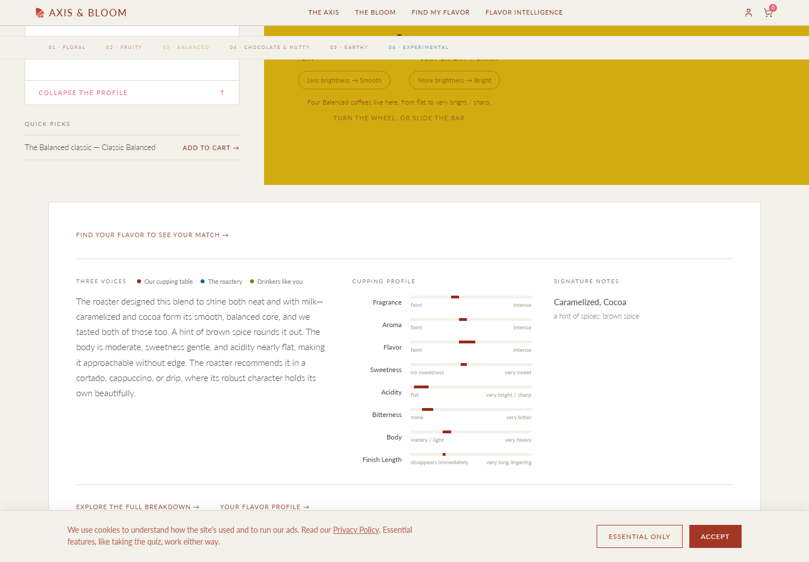

# Closing report: coffee presentation brief 1 (the roaster's voice on every customer surface), test DB

Brief: `CLAUDE_CODE_PROMPT_COFFEE_PRESENTATION_1.md`. Date: 2026-10-23.

**Status: done on the test DB (`axisandbloom_test`). Nothing committed, pushed or run on prod. Prod waits for Dana's go.**

| Check | Result |
|---|---|
| Full suite (`--no-file-parallelism --exclude 'dist/**'`) | 842 tests: 833 pass, 9 fail. Six are the known OT-19 `quizScoring` failures. One was mine: the new view comment was 1,956 characters, over the format test's hard stop of 1,000; shortened to 930, and the test now passes. Two `quizResultsView` tests timed out at 120 s while my screenshot backend's `schema.sql` boot was deadlocked against a suite transaction; I stopped that backend, and the file passes 8 of 8 alone. **Net: only the OT-19 six.** |
| New tests | 19 pass: `src/db/coffeePresentation.test.ts` (8: view, caps, voice), `src/services/coffeePresentation.test.ts` (10: guard, prompt snapshot, SignatureLine), `evidenceAdmin.test.ts` admin flavor-wheel route (1) |
| Brief 6 customer-voice tests (a) to (g) | pass; (g) rewritten for the two caps |
| Lints | `lint:catalog`, `lint:retention`, `lint:customer`, `lint:lineage`, `lint:roastery-portal`, `lint:cupping`: all exit 0 |
| Backend build | clean |
| Frontend build | clean; frontend tsc shows the same 13 pre-existing errors, none in a touched file |
| `runCatalogIntegrityChecks().allPass` | true (globalSetup, on the test DB after the change) |
| `schema.sql` idempotent | applied twice with no error (globalSetup) |
| Writes on test | one ALTER (the topic CHECK); 2 parameter rows + the closing row; 1 award remark; content texts of 22 active coffees; no table, no catalog row, no signal, no merge, nothing deleted |

## Read these before the go

1. **Coado's order is the data's answer, and the data is thin.** No node on test is named by more than one roaster channel: there are no accepted form notes for any of the four coffees, and the website is the only remark channel naming descriptors. So `n_roaster_channels` ties everywhere and each group falls to the roaster's form rank, then confirmed, then alphabetical. Coado's line is **Almond, Chocolate, Peanuts**, not Dana's "Chocolate, Almond, Peanut". Accepting the portal notes (the form channel) is what would move Chocolate first.
2. **Cherry tops Coado's accent through a mapping artifact.** The portal form's notes for Tiger Stripe are a single rank-1 row: `"Chocolate, Peanut Butter, Pear, Fig, Almond, Cherry"`, and that whole string is mapped to **Cherry**. So Cherry has `roaster_rank = 1` although the roaster wrote Chocolate first. I did not touch the mapping (no evidence write beyond the award). Splitting that answer into ranked nodes, or remapping it, is Dana's call.
3. **Why Coado's prose was null.** No Cloud Scheduler job exists for `/api/cron/coffee-content-backfill`. `gcloud scheduler jobs list` shows only `purge-stale-anonymous-guests`, so the "daily" backfill has never run on a schedule. On test, all 22 active coffees had null `ai_summary` / `surprise_note` / `three_voice_story` and **no** `*_generation_failed` flag: never generated, not refused. **Prod's F1 (the flags and nulls for 2914) is not run.** The auto-mode guard blocked prod reads and the instruction was test only, so it is the first step on the go.
4. **Prod regeneration does not touch texts that already exist.** `backfillCoffeeContent` only fills null fields. If prod's active coffees already have texts from before this brief, decision 11's two steps (clear flags, run the backfill) leave those old texts in place. Options: (a) the existing admin `refresh-content` per coffee (force; it also regenerates `story` where it is not admin-edited); (b) null the three texts on active coffees first, then the backfill (story untouched). **Needs Dana's pick.** On test I used (b) for the second run below.
5. **The award row is a one-off loader, not a boot seed.** The brief says both "through the remark writer, never inline SQL" and "guarded so a second boot does not insert it again". The writer (`roasteryRemarkService.recordRemarks`) is TypeScript and cannot run from `schema.sql`. So `load/recordAward2914.ts` writes it, refuses a database other than `--expect-db`, and skips when the row exists (proved: the second run wrote nothing). On prod it runs once after the deploy.
6. **`customer_voice_max_words` is closed, not re-valued.** The seed marks its current row superseded and adds a closing row that is itself superseded at the same instant, with the note `| closed <date>: replaced by signature/accent caps, coffee presentation brief 1`. The key has no current value (`param()` is null) and drops off the Evidence parameters card. Nothing reads it.
7. **The prompts were tightened after the first test run** (texts from both runs below). The first run invented customers ("customers often describe it as approachable") for coffees with no customer notes. It also said "our cupping revealed…", and named "Brazilian" from a `process` remark that mentions the Mogiana region. Three rules were added, and the second run is clean on all three. Two loose phrasings remain in Union's texts (item 12 below).
8. **A latent bug fixed in passing.** In `generateAndStoreAllContent` every null result was labelled "blocked" (`.then(text => { if (text === null) summaryBlocked = true })`), refusals included. So a refused field was never stored or flagged and was retried on every run, contrary to the C3 comments. Decision 9 ("a second failure marks the field failed") needs the two apart, so `contentGuard.generateWithLeakGuard` now returns `blocked` and `reason` separately.
9. **Family words in the accent clause.** "a hint of fruity: cherry, apple, dried fruit" reads acceptably. "a hint of nutty / cocoa: hazelnut" (Fabricator, a Fruity coffee) and "a hint of sour / fermented: …" do not. Per decision B1, the fix is a display-label column on `cupping_note` in a later brief, not a map in code.
10. **Edge cases decided.**
    - A coffee whose match archetype has an empty `descriptor_families` (experimental) is treated like no archetype: all signature. Otherwise every row would be an accent. No active coffee is experimental today.
    - The roaster's `proposedArchetype` is in the voice's shape but **not** in the prompts. It is a classification proposal, not a tasting fact, and on Coado it says "fruity".
    - Remarks reach the voice from the website (latest capture), table and email channels only, as decision 6 lists; call, visit and other do not.
    - A remark or portal answer carrying an award token, the roaster's name, the raw coffee name or the origin text is withheld whole. On Coado that is the general remark "Winner of a 2023 Golden Bean medal, …" and the portal answer "Golden Bean Awarded Coffee in the Espresso Category".
11. **Screenshots.**
    - **Reveal panel:** Benchmark ("Classic Balanced"), because it is the only report coffee placed on the dial on test. Placing Coado would be a catalog write. Coado's own reveal panel can be shot on prod after the go.
    - **Admin block: not taken.** The marked Zzz test admin was disabled after brief 6, and re-enabling it is a change to the production Firebase Auth project. The admin route is covered by a test instead, which checks the roastery rows equal the public read's. Say if the Zzz admin may be re-enabled for the shot.
12. **Residual text notes (second run):** Union's surprise note credits the roaster with "building intensity into the fragrance", which is structure loosely attributed. Union's story says it "tastes equally at home black or with milk" although Union has no portal `takes_it`.

## F1: before any change (test)

| coffee | ai_summary null | surprise null | three voices null | story null | summary failed | surprise failed | three voices failed | story failed |
|---|---|---|---|---|---|---|---|---|
| 2914 Tiger Stripe Espresso | yes | yes | yes | yes | no | no | no | no |
| 2917 Fabricator House Roast | yes | yes | yes | yes | no | no | no | no |
| 2905 Benchmark | yes | yes | yes | yes | no | no | no | no |
| 2934 Union | yes | yes | yes | yes | no | no | no | no |

All 22 active coffees: `ai_summary` null, 0 with any failed flag. `coffees` has no `updated_at` column (the brief asked for it); `story_generated_at` is null for all four. Cloud Scheduler: no `coffee-content-backfill` job (item 3).

## The rows: before and after (test)

Before = brief 6's `v_coffee_customer_descriptor` in `display_order` (the page took the top 5 by `mentions × intensity`, all tied, so it showed the view's order and put the rest behind "The quieter notes"). After = this brief's view (✓ confirmed by our cupping; rank = the roaster's form rank).

**Tiger Stripe / Coado (2914), match chocolate_nutty (families Nutty / Cocoa, Sweet)**
- Before, on the page: Almond, Chocolate, Peanuts, Apple, Cherry; behind the expander Dried Fruit, Fruity, Pear.
- After:

| display | group | descriptor | tier | family | signature | qualifies | channels | rank | confirmed | customer sees |
|---|---|---|---|---|---|---|---|---|---|---|
| 1 | 1 | Almond | 3 | Nutty / Cocoa | yes | yes | website | – | ✓ 1 of 1 | signature |
| 2 | 2 | Chocolate | 3 | Nutty / Cocoa | yes | yes | website | – | ✓ 1 of 1 | signature |
| 3 | 3 | Peanuts | 3 | Nutty / Cocoa | yes | yes | website | – | ✓ 1 of 1 | signature |
| 4 | 1 | Cherry | 3 | Fruity | accent | yes | website | 1 | – | accent |
| 5 | 2 | Apple | 3 | Fruity | accent | yes | website | – | – | accent |
| 6 | 3 | Dried Fruit | 2 | Fruity | accent | yes (no leaf under it) | website | – | – | accent |
| 7 | 4 | Pear | 3 | Fruity | accent | yes | website | – | – | hidden by cap |
| – | – | Fruity | 1 | Fruity | accent | no (family) | website | – | – | hidden by tier |

- The page now: **Almond, Chocolate, Peanuts** / *a hint of fruity: cherry, apple, dried fruit*.

**Fabricator House Roast (2917), match fruity (families Fruity, Sour / Fermented)**
- Before: Citrus Fruit ✓, Hazelnut ✓, Cinnamon.
- After: **Citrus Fruit** ✓ (signature) / *a hint of nutty / cocoa: hazelnut* (✓, form rank 1) / *a hint of spices: cinnamon*.

**Benchmark (2905), match balanced_sweet (families Sweet, Nutty / Cocoa, Fruity)**
- Before: Brown Spice ✓, Caramelized ✓, Cocoa ✓.
- After: **Caramelized, Cocoa** (both ✓) / *a hint of spices: brown spice* (✓).

**Union (2934), match balanced_sweet**
- Before: Caramelized ✓, Nutty ✓.
- After: **Caramelized, Nutty** (both ✓, Caramelized form rank 1); no accent clause.

Whole test DB: 175 customer-voice rows, 167 qualify, 60 are accents, 0 have more than one roaster channel, 18 carry a form rank.

## F2: the regenerated texts (test)

`clearContentGenerationFlags()` cleared 0 rows (none were set). `backfillCoffeeContent()` result:

- **Run 1** (prompts as first written): candidates 22, processed 22, succeeded 22, blocked false, errors 0, **leak rejects 0**, 85 s.
- **Run 2** (prompts tightened, item 7; the three texts nulled on the 22 active test coffees first): candidates 22, succeeded 22, errors 0, **leak rejects 0**, 44 s. Afterwards all 22 active coffees have all three texts and 0 failed flags.

### Run 2 (current prompts)

**2914 Tiger Stripe Espresso** (leak tokens: `joe bean roasters`, `tiger stripe espresso`, `2023`, `golden`, `bean`, `medal`)
- ai_summary: An award-winning blend, as the roaster tells it, built on almond, chocolate, and peanuts—the roaster calls it perfect on its own or with steamed milk. The roaster notes a hint of cherry, apple, and dried fruit threading through. Moderate body with a lingering finish, and we tasted those core notes too.
- surprise_note: This award-winning blend delivers the roaster's signature almond and chocolate core with unexpected brightness—a hint of cherry and apple cuts through the richness, proving that deep, nutty coffees don't have to be one-dimensional.
- three_voice_story: The roaster calls it almond and chocolate with peanuts at its heart, and we tasted that chocolate and almond too. A hint of cherry and dried fruit peek through—the roaster's accent notes. It's an award-winning blend, as the roaster tells it, built for both black coffee and steamed milk alike. Expect a rounded body with a finish that lingers, moderate acidity, and restrained sweetness—a coffee that tastes complete on its own terms.

**2917 Fabricator House Roast**
- ai_summary: Bright citrus fruit leads this medium-roasted blend, with hazelnut and a hint of cinnamon rounding out the cup—the roaster calls it beautifully balanced, and we tasted the citrus and hazelnut too. Moderate body and acidity keep it crisp and approachable, whether you brew it as filter coffee or espresso. The finish lingers gently, letting those citrus notes linger on your palate.
- surprise_note: What makes this Fruity archetype unusual is its versatility: the roaster calls it beautifully balanced with bright citrus fruit at its core, yet it shines equally whether you brew it simple (auto drip) or concentrated (espresso)—a rare flexibility for a fruit-forward coffee.
- three_voice_story: The roaster calls this blend citrus fruit forward, with just a hint of hazelnut and cinnamon—and we tasted that citrus and hazelnut too. It's beautifully balanced with moderate body and brightness, drinking equally well black or with milk across a range of brewing methods. The finish lingers gently, leaving the citrus as your parting note.

**2905 Benchmark**
- ai_summary: Classic Balanced brings together caramelized sweetness and cocoa as its foundation, with a hint of brown spice rounding out the cup. The roaster crafted this medium-roast blend to be smooth and robust—equally at home in milk or on its own—with a moderate body, gentle acidity, and a clean finish. It's designed for drip brewing and espresso alike.
- surprise_note: The roaster designed this blend to vanish into the background—no rough edges, pure comfort—yet it's equally at home as the star of your cup, shifting between supporting player and main character depending on how you brew it.
- three_voice_story: The roaster designed this blend to shine both neat and with milk—caramelized and cocoa form its smooth, balanced core, and we tasted both of those too. A hint of brown spice rounds it out. The body is moderate, sweetness gentle, and acidity nearly flat, making it approachable without edge. The roaster recommends it in a cortado, cappuccino, or drip, where its robust character holds its own beautifully.

**2934 Union**
- ai_summary: The roaster calls this a caramelized and nutty blend with a medium roast and washed process—notes we tasted too. Expect a moderate body with restrained acidity and subtle sweetness, making for an approachable, everyday cup. The finish fades fairly quickly, letting the core caramel and nut flavors shine without lingering complexity.
- surprise_note: This balanced blend punches above its weight—despite a deliberately restrained finish that fades quickly, the roaster builds surprising intensity into the fragrance, making it smell far more complex than it tastes.
- three_voice_story: The roaster calls it caramelized and nutty—the core of this medium-roasted blend—and we tasted both too. The cup settles into a moderate body with gentle sweetness and restrained acidity, letting those roasted notes linger without sharp edges. A washed process keeps it clean and approachable, the kind of coffee that tastes equally at home black or with milk.

### Run 1 (first prompts), the lines that led to item 7

- 2934 three voices: "…customers often describe it as approachable and grounding…" (Union has no customer notes)
- 2917 three voices: "…The naturally processed Brazilian element gives it a rounded body… Customers who love this archetype appreciate how the citrus sings…"
- 2905 surprise: "The roaster designed this blend to work everywhere—milk or black—yet our cupping revealed something unexpected: it disappears almost instantly…" (our cupping as our tasting, and a 4/15 finish called "almost instantly")
- 2914 was already as intended in run 1 ("This award-winning blend delivers almond, chocolate, and peanuts as its core—flavors the roaster emphasizes and we tasted too—with just a hint of cherry and dried fruit…").

## Screenshots (1440, local backend on the test DB, guest)

**Reveal panel, Benchmark ("Classic Balanced", `/bloom?archetype=balanced_sweet&slot=2`):** the Signature notes block reads **Caramelized, Cocoa** with *a hint of spices: brown spice* beneath it. The cupping bars and the Three voices prose are untouched (the prose is the run 2 story above). The Three voices legend still names "Our cupping table", the existing `TastingNotes` legend that B4 keeps; worth a look in a later pass.

The collapsed card before the reveal: `cp1_bloom_card_1440.png`. Its teaser is the surprise note's first sentence, since every test coffee now has one. The signature-line fallback shows only when the surprise note is null, and is covered by the code path and the SignatureLine tests.

The admin block was not shot (item 11).

Operational note: booting a backend on the test DB while the suite runs can deadlock. The boot's `schema.sql` batch waits on a test's open transaction, and that test waits on a query the schema batch blocks. Postgres cannot see the cycle. Don't run both at once.

## What changed, part by part

**Part 0.** `customer_voice_signature_max` 4 and `customer_voice_accent_max` 3 are seeded beside the brief 6 rows, same guard, each note ending `Range: integer 1 <= value <= 10.` `customer_voice_max_words` is closed (item 6). No key list exists in code: the Evidence parameters card lists every current row, so it shows the two with no code change. `lint:cupping` has no key list either; nothing to extend.

**Part A.**
- `v_coffee_customer_descriptor` (same name, every brief 6 column in its old order) adds `family_id`, `family`, `is_signature`, `n_roaster_channels`, `roaster_channels`, `roaster_rank`, `cupping_share`, `qualifies` and `group_order`; `display_order` is recomputed.
- It reads `roastery_portal_response_note` through `v_roastery_portal_current_response` for the rank. No new view: the four views in decision 6 hold every other column.
- `cuppingReads.getCustomerDescriptors` returns qualifying rows within both caps. `getCustomerDescriptorsAll` returns every row with `customer_sees`.

**Part B.**
- `CollaborativeFlavorWheel` `variant='signature'` renders `SignatureLine` (new, `coffee-info/SignatureLine.tsx`, its text logic in `lib/signatureLine.ts`); `SIGNATURE_COUNT`, `computeStrength`, `SignatureNotes` and the expander are deleted.
- `usePositionCardData` fetches the wheel once per slot, not on reveal. The teaser is the surprise note's first sentence, else the signature line.
- The grouped variant draws rows in the read's order with no per-category cap (`VISIBLE_PER_CATEGORY` and "+N more" deleted).
- `RevealedPanel` is unchanged: the "Signature notes" label stays.

**Part C.**
- `services/roasterVoiceReads.ts`: `getRoasterVoice(coffeeId, runner, { descriptorsOnly })`, `getAwardRemarks` (for the guard only), `numericDimensionRows` (moved from `routes/coffees.ts`) and `signatureWords`.
- It reads through `cuppingReads`, `roasteryRemarkReads.listRemarks` and the new `roasteryPortalReads.getCurrentResponseForCoffee`, so both lints accept it as a reader.
- `fetchCoffeeDataForContent` reads the voice and no longer reads descriptors or dimensions itself. `sommelierRag`, the arrival note (`routes/cron.ts`) and `beatEngine` take the signature words, already capped by the parameter, instead of `slice(0, 4)`.

**Part D.**
- **D1:** the CHECK is widened by name in a guarded DO block (and in the CREATE for a fresh database). `REMARK_TOPICS` gains `award`. The award row: item 5.
- **D2:** the three prompts take the voice through one renderer (`renderVoice`) and one rule block (`VOICE_RULES`). The story writes when there is at least one signature note, one remark or one portal answer. Still Haiku.
- **D3:** `contentGuard.bannedTokensFor`, `looksLikeLeak` and `generateWithLeakGuard` (one retry, then null with the reason). The backfill reports `leakRejects`. The admin refresh-summary path uses the same guard.
- **D4:** the story's reject list gains the same tokens (`identity.leakTokens`).

**Part E.**
- **E1:** `GET /api/admin/flavor-wheel/:id`'s roastery branch is the customer voice's ranks 1 and 2, with channels, form rank, cupping, `is_signature`, `qualifies`, `display_order` and `customer_sees`. The internal branch is unchanged, and the client branch still comes from the wheel.
- **E2:** `AdminFlavorWheel` shows **What the customer sees**: the line and clause from the public `/flavor-wheel`, the three texts from the public `/content`, and Regenerate (the existing `refresh-content`), then reloads. The roastery table shows `form` / `website` tags and a grey customer-sees tag.
- **E3:** the Descriptors tab (workbench and Coffees page evidence panel) has a `Customer sees` column, per family, naming each node and how it shows. The evidence bundles carry `customerVoice`.

**Part F.** `coffees.clearContentGenerationFlags()` clears the three flags on active coffees, never the story flag. F1 and F2 are above.

## Tests

- **New `src/db/coffeePresentation.test.ts`** (every fixture rolled back):
  - The seed's chocolate_nutty families, read rather than assumed: Nutty / Cocoa and Sweet. There is no Roasted, as the brief supposed.
  - The brief's fixture: Chocolate (accepted + form rank 1 + website) and Almond as signature in that order; Apple, Cherry and Dried Fruit as accents alphabetically; Fruity does not qualify.
  - Dried Fruit with **Raisin** under it does not qualify. The wheel has no Fig node: the roaster's "Fig" maps to Dried Fruit.
  - `cupping_share` 0.5; no match archetype gives all signature rows.
  - Caps of 1 and 1 give Chocolate and Apple, and `customer_sees` for every row.
  - `getRoasterVoice` carries none of the roaster name, coffee name, origin, origin remark, award text, "Golden" or "Winner".
- **New `src/services/coffeePresentation.test.ts`:**
  - Token list.
  - "Golden" and "2023" reject, the name rejects, and a clean text passes ("Beans" is not "bean").
  - The retry with a stubbed client: a leak then a clean text keeps the second; two leaks give null with `leak: 2023`. Refusal, blocked and a clean first text are covered too.
  - The prompt snapshot (`__snapshots__/coffeePresentation.test.ts.snap`) with no roaster name or award text, both lists present and remarks labelled paraphrase. The story is not asked for when the voice is empty.
  - SignatureLine renders "Chocolate, Almond" and "a hint of fruity: cherry, apple", with no clause when there are no accents and two clauses in order. No `slice(0, <digit>)` in the line, the component or the wheel.
- **`evidenceAdmin.test.ts`:**
  - The bundle key list gains `customerVoice`.
  - The parameter list expects the two new keys and not `customer_voice_max_words`.
  - New: the admin flavor-wheel route's shown roastery rows equal the public read's, and Fruity is "hidden by tier".
- **`evidencePooled.test.ts` (g):** the signature cap applies; the accent cap leaves signature rows alone; `param('customer_voice_max_words')` is null.

## `comments.sql`

**Updated:**
- `VIEW v_coffee_customer_descriptor`: Purpose (the new columns and the one label comparison), Readers (`getCustomerDescriptors` via `roasterVoiceReads`, `getCustomerDescriptorsAll` via admin and the evidence reads), Since.
- `TABLE evidence_parameter`: the key list, `customer_voice_max_words` closed, the two new keys.
- `COLUMN roastery_remark.topic`: `award`.
- Readers lists, adding `v_coffee_customer_descriptor` or `roasterVoiceReads`: `TABLE roastery_portal_response_note`, `VIEW v_roastery_portal_current_response` (via `getCurrentResponseForCoffee`), `VIEW v_cupping_note_family`, `VIEW v_coffee` (+8 more), `TABLE coffee_archetype`, `VIEW v_coffee_dimension_range`, `VIEW v_roastery_remark`.
- `TABLE coffees` Writer: `coffees.guardGenerated` (never a writer, and the function is gone) is replaced by `coffees.clearContentGenerationFlags`. The three `*_generation_failed` columns' Writer gains `coffees.clearContentGenerationFlags`.

The boot on test applied 1,327 statements with no error. **`CATALOG.md` is not regenerated yet:** as in brief 6, it is generated from prod after the deploy.

## Dana's go (2026-10-23): three more rules, then prod

Dana gave the go with three rules added to `VOICE_RULES`:
- never an em or en dash;
- never the word "archetype" or an archetype name as a category;
- milk or black only when the portal's `takes_it` is present.

She chose option (b) for item 4, no Firebase Auth change (so no admin screenshot), and a Cloud Scheduler job for the backfill.

**What changed for the rules:**
- **Prompts:** the three prompts lost their own dashes ("2–3 sentence", the "5.0–9.0/15" ranges, the em dashes in the surprise and story prompts). They no longer pass the archetype ("a Chocolate & Nutty coffee", "defies the archetype"). The three texts now name the coffee by its display name, else "this coffee", never the archetype label the old `safeName` fell back to. `takes_it = both` is rendered as "black or with milk".
- **Rerun with the prompt alone:** null the three texts on the 22 active test coffees, then the backfill. Of 66 texts, 11 had an em dash (Coado's surprise note among them) and 4 used an archetype as a category ("this fruity blend", "fruity coffees"). Milk / black: 0 breaks (Union, the one coffee without `takes_it`, said nothing about milk). **The prompt does not hold the rules alone.**
- **So they are enforced in `contentGuard`:**
  - `normalizeDashes`: a dash between numbers, units allowed, becomes "to" ("40g – 45g" → "40g to 45g"); any other dash becomes a comma.
  - `styleViolation`: the word "archetype"; an archetype name in front of coffee, blend, cup, style, profile, family, type or category, with the names read from `v_coffee_archetype`, never typed in code; or milk / latte / cortado / cappuccino / flat white when there is no `takes_it`.
  - `generateWithLeakGuard` normalises first, then rejects on style, up to three attempts in all; a third style reject marks the field failed. The leak guard keeps its single retry.
- **Geometric:** with the guard, its `ai_summary` failed three times ("fruity cups"). The source is the roaster's remark "designed for those who love bright, fruity coffees". `getRoasterVoice` now withholds a remark that `styleViolation` flags as a category, the same way it withholds an award text.
- **Final test run** (texts nulled again first): 22 of 22 coffees, 0 leak rejects, one style reject retried (Amsterdam), **66 of 66 texts pass all three rules, 0 failed fields** (`tmp/cp1_rules.mts`, which checks every active coffee, not only the four).
- **Tests:** 3 new (dash normalisation, the style check, the style retry), and the prompt snapshot asserts no dash and the new rule lines.

**The four coffees, final test run:**

**2914 Tiger Stripe Espresso** (takes_it both)
- ai_summary: The roaster calls this award-winning blend almond, chocolate, and peanuts at its heart, with and we tasted it too. You'll find a hint of cherry, apple, and dried fruit threading through. It's an approachable cup with moderate body and a lingering finish, best enjoyed black or with steamed milk. Per the roaster, dial in around 18g for a 40-45g yield in 35-40 seconds.
- surprise_note: An award-winning blend built on almond, chocolate, and peanuts that reveals a hint of cherry and apple underneath, defying the expectation that nutty roasts are straightforward and one-dimensional.
- three_voice_story: The roaster calls it almond and chocolate with peanuts at its core, and we tasted all three too. A hint of cherry and apple adds brightness beneath the main flavors. The roaster recommends it black or with steamed milk, and it holds a long finish. This award-winning blend has a moderate body and gentle sweetness, making it approachable on its own or creamy with milk.

(The summary's "at its heart, with and we tasted it too" is a garbled clause from the model, not a rule break. The ranges "40-45g" use a plain hyphen, which the rule allows. Prod generates its own texts.)

**2917 Fabricator House Roast** (takes_it both)
- ai_summary: Bright citrus fruit takes the lead in this medium roast blend, anchored by a naturally processed element that brings balance and versatility. A hint of hazelnut and cinnamon rounds out the cup, which the roaster calls beautifully balanced and recommends enjoyed black or with milk. Moderate body and acidity make it equally at home in an auto drip, pour over, or espresso.
- surprise_note: Citrus fruit takes center stage in this medium roast blend, yet it drinks beautifully with milk or black and handles everything from drip to espresso without losing its brightness. The roaster's naturally processed element adds a hazelnut sweetness that shouldn't work with citrus, but does.
- three_voice_story: The roaster calls this blend citrus fruit forward with a hint of hazelnut and cinnamon, and we tasted the citrus fruit and hazelnut too. Beautifully balanced across a moderate body with gentle acidity, it brews well multiple ways. The roaster recommends it black or with milk, and the finish lingers pleasantly through the cup.

**2905 Benchmark** (takes_it both)
- ai_summary: The roaster describes this blend as smooth, balanced, and robust, with caramelized and cocoa as its core flavors, and we tasted those notes too. A hint of brown spice rounds out the cup. The roaster designed it to shine both on its own and with milk, with a moderate body, gentle sweetness, and minimal acidity that lets the caramel and cocoa linger softly. Medium-roasted and washed, it's equally at home in drip coffee or espresso.
- surprise_note: This blend trades the expected heaviness of cocoa and caramel for a remarkably light, clean body that feels almost delicate, yet the roaster designed it specifically to hold its own with milk or black, refusing to disappear either way.
- three_voice_story: The roaster calls this blend caramelized and cocoa at its heart, with a hint of brown spice, and we tasted the caramel and cocoa too. It's smooth and balanced, designed to work equally well black or with milk. The cup has moderate sweetness and body, with minimal acidity and bitterness, making it forgiving and approachable whether you brew it as drip or espresso.

**2934 Union** (no takes_it: nothing about milk or black)
- ai_summary: The roaster calls this medium-roasted blend caramelized and nutty at its core, and we tasted those notes too. The cup has a moderate body with gentle sweetness and restrained acidity, making for an approachable, rounded experience. Bitterness is minimal, though the finish fades quickly rather than lingering.
- surprise_note: A blend built on caramelized and nutty notes typically settles into comfort, yet this one keeps you reaching for another sip with its restless fragrance and surprisingly crisp finish that refuses to linger.
- three_voice_story: The roaster calls it caramelized and nutty, and we tasted both notes too. This medium-roasted blend offers moderate sweetness balanced by gentle acidity, with a body that sits comfortably in the middle ground. The finish is brief, letting the warm caramel and roasted nut flavors fade quickly from your palate.

**Before the commit:** the full suite ran again after the rule changes: 845 tests, 839 pass, 6 fail (the OT-19 `quizScoring` six only). The six lints and both builds are clean.

**Prod F1 (read-only, before the commit):** the same picture as test. Of 22 active coffees, none has an `ai_summary`, surprise note or three-voice story; none has a failed flag; none has an admin-edited story. 2914, 2917, 2905 and 2934 are all null with all four flags false and `story_generated_at` null. No `award` row exists. The texts were never generated on prod either, so option (b)'s nulling has nothing to null.

## Prod, on Dana's go (proposed order)

1. **F1 on prod, read-only, before anything lands:** 2914's three nulls, the four flags and `story_generated_at`, plus how many active coffees already have texts (this decides item 4).
2. Commit straight to main. Contents: schema, `comments.sql`, the reads, the prompts, the guard, the routes, the frontend, admin, tests and the snapshot, the loader, `WHAT_WE_BUILT.md` #231, the `WHAT_WE_BUILT_DB.md` line, `SOMMELIER_BUILT.md` S113, this report and its screenshots. Then push, and watch GitHub Actions deploy and the boot log (`DB schema verified`, `[db-comments]`).
3. Run `load/recordAward2914.ts --expect-db axisandbloom` once (dry run first).
4. F2 on prod: `clearContentGenerationFlags()`, then the backfill, with Dana's pick from item 4 for texts that already exist. Print the texts for 2914, 2917, 2905 and 2934, and the leak-reject count.
5. Run `npm run catalog:md -- --expect-db axisandbloom` and commit `CATALOG.md`.
6. Verify on prod: Coado's reveal panel at 1440, and the admin block if the Zzz admin may be re-enabled.

Not in this brief, worth a decision: a Cloud Scheduler job for `/api/cron/coffee-content-backfill` (item 3), so new coffees get texts without a manual run.
