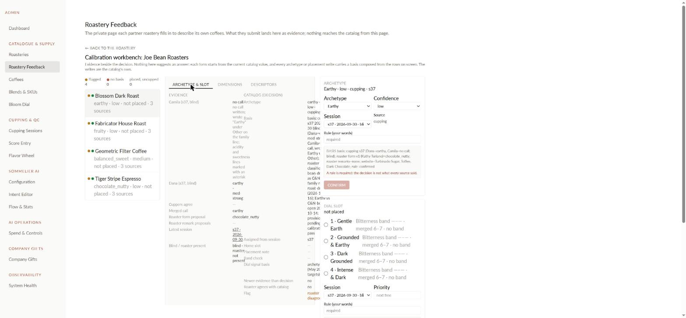
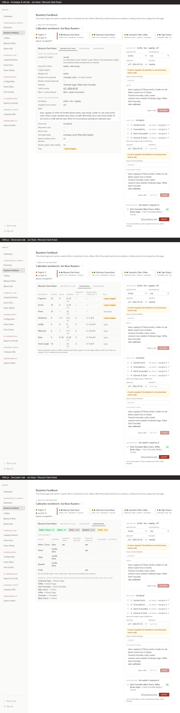
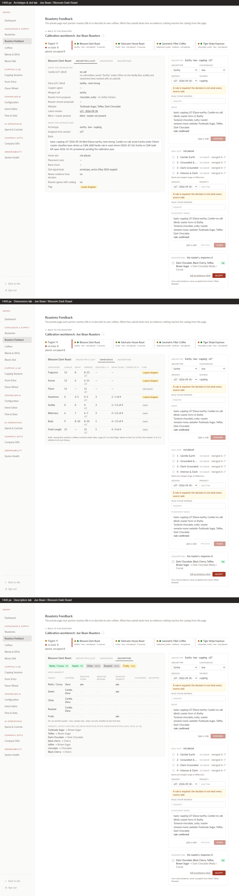
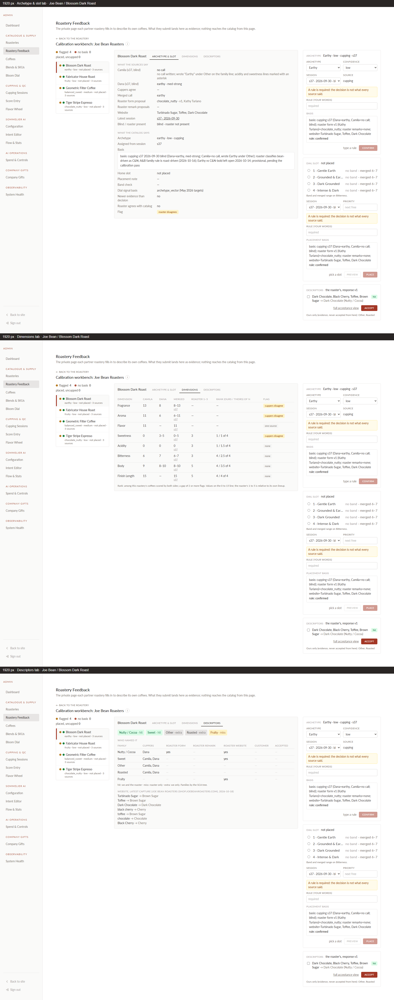

# Closing report: cupping evidence brief 4b (workbench readability)

Brief: `CLAUDE_CODE_PROMPT_CUPPING_EVIDENCE_4b_WORKBENCH_READABILITY.md`. Date: 2026-10-21. Display only: same reads, same writes, same components. No backend file changed, no schema, no writer.

## Before

## After

Each image stacks the Archetype & slot, Dimensions and Descriptors tabs for Joe Bean / Blossom Dark Roast, with the three decision cards in every shot. Playwright, local backend on the test DB, signed in as the marked Zzz Test admin.

### 1366 px

### 1440 px

### 1920 px

## Part F audit

Measured in the page on the workbench root, for every visible text element:

- **small:** computed font size under 12 px;
- **clipped:** content wider than a hidden-overflow box with no `title` to show it, or text past the workbench's or its card's right edge;
- **overprint:** per-line glyph boxes of two different elements overlapping (truncated text measured as painted, cut to its box);
- **word per line:** a run of 3+ words laid out one word per line.

| Width | Layout | Tab | small | clipped | overprint | word per line |
|---|---|---|---|---|---|---|
| 1366 | mid | Archetype & slot | 0 | 0 | 0 | 0 |
| 1366 | mid | Dimensions | 0 | 0 | 0 | 0 |
| 1366 | mid | Descriptors | 0 | 0 | 0 | 0 |
| 1440 | mid | Archetype & slot | 0 | 0 | 0 | 0 |
| 1440 | mid | Dimensions | 0 | 0 | 0 | 0 |
| 1440 | mid | Descriptors | 0 | 0 | 0 | 0 |
| 1920 | wide | Archetype & slot | 0 | 0 | 0 | 0 |
| 1920 | wide | Dimensions | 0 | 0 | 0 | 0 |
| 1920 | wide | Descriptors | 0 | 0 | 0 | 0 |

The layout follows the workbench's own width, not the window width. At 1366 and 1440 the admin sidebar and page padding leave about 1,150 to 1,226 px, so both get the **mid** layout: the queue as a strip of chips above the evidence and the cards. At 1920 the workbench gets the **wide** three-pane layout (queue 260 px | evidence | cards 380 px). Below 1,024 px everything stacks in one column. The root carries `data-workbench-mode` so the mode can be checked.

Checks: six lints exit 0; backend build and frontend build clean; frontend typecheck has the same 13 pre-existing errors as before, none in the touched files; `evidenceBasis` + `evidenceAdmin` tests 34/34. No backend code changed, so the full backend suite was not re-run.

## What changed

- **`EvidencePanel.tsx`:**
  - body text 14 px, labels 12 px uppercase, figures tabular;
  - Dimensions: a scrolling table with the session link under each value, a "Rank (ours / theirs) of n" header and a key line;
  - Descriptors: larger chips and a "Who named it" table;
  - Archetype & slot: one column in two sections ("What the sources say", "What the catalog says") of label/value rows, with basis and placement note on full-width rows;
  - `BasisText` puts the `; rule:` part of a basis on its own bold line, and is shared with the cards' preview.
- **`AdminCalibrationWorkbench.tsx`:**
  - the width-driven layout described above;
  - the explanation sentence moved into an info icon;
  - queue rows on two lines, with an accent bar on the selected row;
  - cards: a title line (what the card decides · its current value), inputs in a two-column grid, an amber band on the rule field when a rule is required, the basis preview, and a right-aligned submit with the reason it is disabled ("type a rule", "pick an archetype", "pick a slot", "already its home").
- **`CalibrationPanel.tsx`:** unchanged, nothing in it is shared with the workbench.

## Deviations from the listed files, both display only

1. **`AdminRoasteryPortal.tsx`, one line.** The admin portal page wraps every view in `max-w-6xl` (1,152 px). That cap kept the workbench below its 1,440 px three-pane layout at every window width. The cap is now dropped for the workbench view only. Other views are unchanged.
2. **Slot rows.** The slot name column is `minmax(0, 12rem)` and truncates, with the full name in its `title`. The band text after it never wraps or clips. Without this, a long slot name pushed the band text past the card edge at 1366.

## How the screenshots were signed in

The test admin's browser sign-in was a Firebase custom token for the Zzz Test admin (uid `OQL5reuEzmOvM307hPetOZbgbr52`, test DB `user_profile` only). The page's `GET /api/users/profile` would create that user's document in Firestore, which the local backend's Firestore write guard blocks with a 500. The guard was left intact. Instead, the browser was given `{isAdmin: true}` for that one call. Every `/api/admin` call still went to the local backend, which checked admin against the test DB.

The Zzz admin was demoted and its Firebase account disabled after the shots. Nothing on prod was read or written by the screenshot run.

## Commit

One commit straight to main: see `git log` (hash in the reply to Dana). Also in the commit: the cupping_evidence `README.md` status edits that were already in the working tree, and the brief-4b row and status line.

Nothing to decide.
