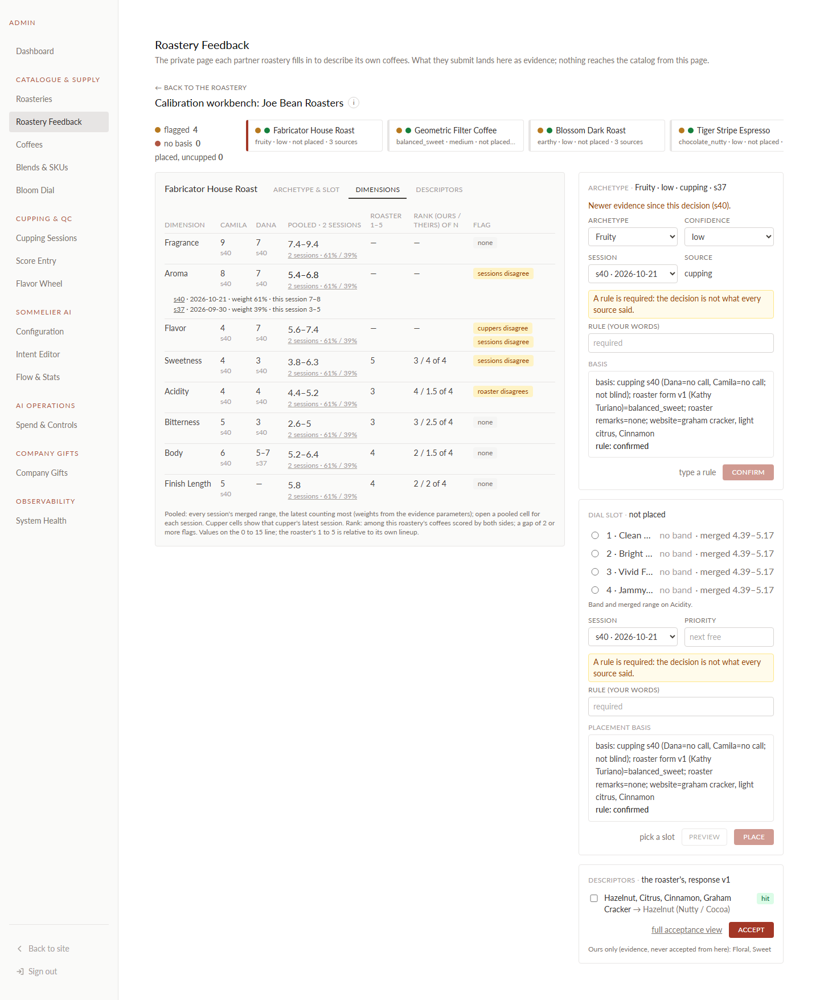
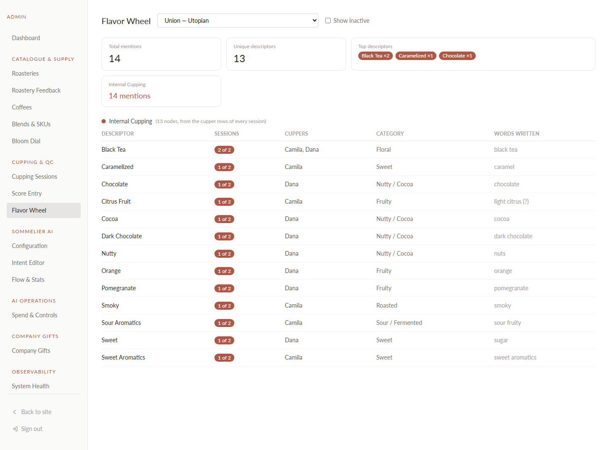
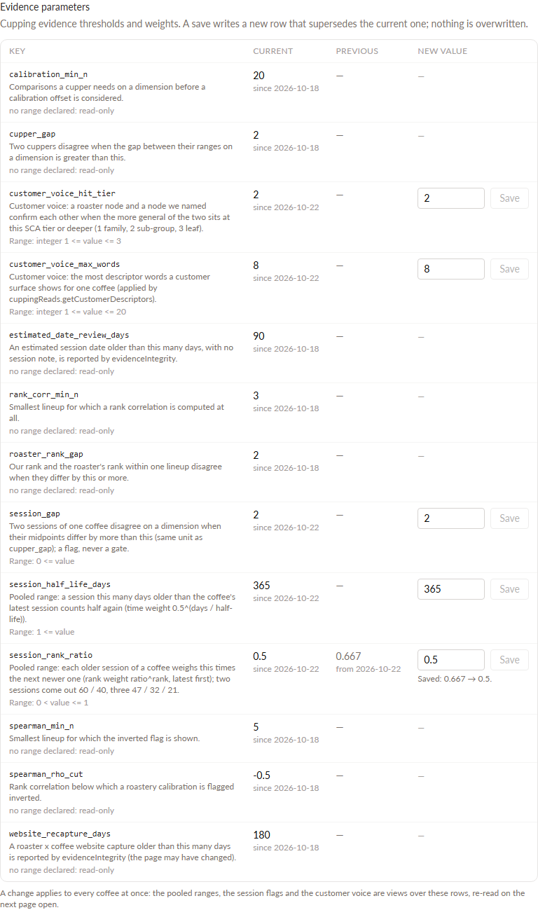
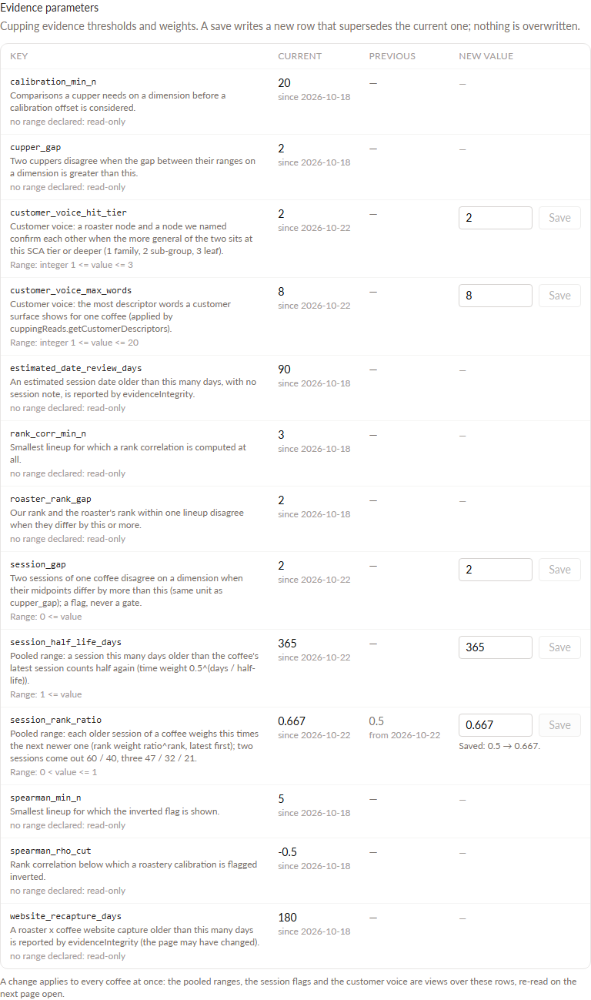

# Closing report: cupping evidence brief 6 (pooled range, consensus, customer voice), test DB

Brief: `CLAUDE_CODE_PROMPT_CUPPING_EVIDENCE_6_POOLED_RANGE_CUSTOMER_VOICE.md`. Date: 2026-10-21.

**Status: done on test; Dana's go and rulings 2026-10-21 (below); committed, deployed and verified on prod (last section).**

| Check | Result |
|---|---|
| Full suite | 817 passed, 6 failed (the OT-19 `quizScoring` six only) |
| Lints | `lint:catalog`, `lint:retention`, `lint:customer`, `lint:lineage`, `lint:roastery-portal` and `lint:cupping` exit 0 |
| Backend build | clean |
| Frontend build | clean (frontend tsc: the same 13 pre-existing errors, none in the touched files) |
| `runCatalogIntegrityChecks().allPass` | true |
| `evidenceIntegrity` | unchanged: the two known failures only (below) |
| Signals, merges, catalog | no signal recorded, no merge, no supersede of a score row, no catalog row, nothing deleted |
| Schema | no table created or altered (five parameters are rows) |

## Eight things to read before the go

1. **The parameters card is on the Configuration page, not System Health.** System Health says in code and in `WHAT_WE_BUILT` #154 that it is read-only by policy (`OBSERVABILITY_POLICY.md`: "no configuration controls of any kind"). The brief named Configuration as the alternative, so the card sits at the top of **Sommelier AI → Configuration** (`/admin/sommelier/config`), its own section titled "Evidence parameters".
2. **Sane ranges live in the notes.**
   - Each of the five new rows' note ends with its range, as the brief says ("held in the seed note"), for example `Range: 0 < value <= 1.` and `Range: integer 1 <= value <= 3.`.
   - `setParameter` parses that range, so no number from the brief is typed in code.
   - The eight older keys have no range in their notes. The card shows them read-only and the service refuses them. Giving them a range is a seed-note change, a new row each; not done here.
   - `evidence_parameter` has no admin column. A change therefore keeps the key's description and range and appends `| changed <date> by <admin uid>: <note>` to the note.
3. **`lint:cupping` changed.** It treated `evidence_parameter` as seed-only.
   - It now allows writes from `services/evidenceParameterService.ts` and reads from that file and `evidenceReads.ts`.
   - `comments.sql` Writer: `evidenceParameterService.setParameterInTx; seed`.
   - `lint:lineage` passes.
4. **Liam reads our words through a second door, now closed.**
   - `v_coffee_descriptor` is read by `v_palate_shared_traits`. That view feeds `customerReads.getSharedTraits` → `liamProfile`, i.e. Liam's profile line ("brown_sugar or caramel on every bag"). So a customer did see the result.
   - Per decision 7, `v_palate_shared_traits` now reads `v_coffee_customer_descriptor`. Same columns; the dimension half is unchanged and reads the pooled range.
   - It is a `CREATE OR REPLACE` late in `schema.sql`, after the customer voice exists. The early definition still runs first on every boot because `v_palate_slot_candidates` depends on it.
   - `v_coffee_descriptor` itself stays as it was and is internal. Its other reader, `cuppingReads.getDescriptors`, has no caller.
5. **Fabricator gets three words, not two.** On test (refreshed from prod) its website capture has four words. `cinnamon` → Cinnamon, `citrus` / `light citrus` → Citrus Fruit, `hazelnut` → Hazelnut, and `graham cracker` has no node. So the customer hears:
   - **Citrus Fruit**: confirmed (we named Citrus Fruit in s40, and Orange under it in s37);
   - **Hazelnut**: confirmed (Camila named Nutty in s40, a tier-2 ancestor of Hazelnut);
   - **Cinnamon**: not confirmed.

   The brief expected two words because Hazelnut is mapped as well.
6. **The public flavor wheel changes shape.** `GET /api/coffees/:id/flavor-wheel` feeds the Flavor Intelligence page, the Bloom page and the feedback chips. It now returns the customer voice:
   - the same row shape: `source` is `roastery` or `client`, `mentions` is `1`, and `confirmed_by_cupping` is added;
   - one row per node, so the bars are equal length and "Our cupping table" no longer appears as a segment;
   - every coffee with no roaster words and no customer feedback now has an **empty** public wheel: on test that is every coffee without a website capture or accepted notes.

   The feedback chips come from the same read, and `routes/orders.ts` validates submitted chip ids against the same read, so the two stay in step. A design follow-up for the wheel component may be wanted.
7. **Cupper prose still reaches two prompts.** `overall_notes` (for example "balanced coffee with no edges.") goes into the summary and surprise-note prompts as "Cupper's notes". Decision 7 covers descriptor words, so I left it. Say if it should go too.
8. **Pooled values are rounded to two decimals, with trailing zeros trimmed** (`trim_scale`), so a whole value still reads `10`, not `10.00`. Liam's profile line printed `10.00–12.00` otherwise. `midpoint` keeps its old two-decimal form.

## Dana's rulings on the eight points (2026-10-21)

Points 1, 2, 3, 5, 6 and 8 were accepted as built. Points 4 and 7 asked for changes, both done before the commit:

**Point 4.** A comment now sits at the early `v_palate_shared_traits` definition in `schema.sql`. It says that definition is not the live one, that the view is redefined after `v_coffee_customer_descriptor` and why, and that the early one is never to be edited.

**Point 7: our cuppers' prose no longer reaches a customer in any form.** Changed:

| Where | Before | After |
|---|---|---|
| `services/claude.ts` `getCoffeeSummary` (ai_summary prompt) | `Cupper's notes: "<overall_notes>"` line | removed; the `overallNotes` parameter is gone |
| `services/claude.ts` `getCoffeeSurpriseNote` (surprise_note prompt) | the same line | removed; the parameter is gone |
| `routes/coffees.ts` `fetchCoffeeDataForContent` | read the latest current row's `overall_notes` (`getOverallNotes`) | no longer read |
| `routes/coffees.ts` `hasSufficientData` (the ai_summary gate) | dimensions, or words, or overall notes | dimensions or words; the notes no longer qualify a coffee on their own |
| `routes/coffees.ts` `generateAndStoreSummary` (admin refresh) | passed `overallNotes` | not passed; words from the customer voice |
| `routes/coffees.ts` `GET /api/coffees/:id/dimensions` (**public**) | returned `notes` = our cuppers' overall notes, shown on the Flavor Intelligence page as "cupping session notes" | `notes` is always `[]` (shape kept; the page renders nothing for an empty list) |

- **Other prompts:** no other customer-facing prompt carries cupper prose. Checked by grepping `overallNotes`, `overall_notes`, `getOverallNotes` and "Cupper's notes" in routes and services. What remains is admin Score Entry, the cupping service and its reads, and comments.
- **Stored content:** stories, summaries and surprise notes already stored are not regenerated.
- **`cuppingReads.getOverallNotes`:** it stays, with no caller now.

## Reader classification (decision 7)

Readers of `v_collaborative_flavor_wheel`, `v_coffee_descriptor` and the views derived from them:

| File / object | What it shows | Who sees it | Now reads |
|---|---|---|---|
| `routes/coffees.ts` `fetchCoffeeDataForContent` | the ai_summary, surprise note and story inputs (top descriptors, voices) | **customer** (coffee page text) | `cuppingReads.getCustomerDescriptors`; inline SQL removed |
| `routes/coffees.ts` `GET /:id/flavor-wheel` | public wheel, Bloom page, feedback chips | **customer** | `getCustomerDescriptors` |
| `routes/orders.ts` feedback POST | validates `tastedNoteIds` against the chips offered | **customer** (what they may pick) | `getCustomerDescriptors` |
| `routes/cron.ts` arrival email | first-bag brew-note sentence, top 4 words | **customer** (email) | `getCustomerDescriptors`, first 4 |
| `services/beatEngine.ts` order-placed line | top 4 words in the beat SMS/line | **customer** | `getCustomerDescriptors`, first 4 |
| `services/sommelierRag.ts` `getDescriptors` | Liam's catalog context, 4 words per coffee | **customer** (Liam) | `getCustomerDescriptors`, first 4 |
| `v_palate_shared_traits` (via `v_coffee_descriptor`) | Liam's profile line, shared descriptors | **customer** (Liam) | `v_coffee_customer_descriptor` |
| `routes/admin.ts` `GET /flavor-wheel/:id` | admin Flavor Wheel | internal | roastery and client branches from the wheel; internal branch from `evidenceReads.getDescriptorConsensus` |
| `evidenceReads.getWorkbenchCoffee` (accepted) | workbench descriptor card | internal | unchanged (wheel, roastery branch) |
| `v_evidence_descriptor` (accepted branch) | hit / miss / extra | internal | unchanged |
| `v_coffee_descriptor` → `cuppingReads.getDescriptors` | no caller | nobody | unchanged |
| `services/catalogService.ts` | a comment only (no query) | none | none |
| `db/seeds/internal_descriptors_session_001.sql` | a commented-out query | none | none |

**Decision 8:** the dimensions a customer sees come from `v_coffee_dimension_range`, now the pooled range. That covers the story inputs, `GET /:id/dimensions` and the palate views. Nothing else changed for them.

## Old vs pooled midpoint, the 22 cupped coffees (test DB, computed, nothing recorded)

"Old" is the latest session's merged midpoint; "pooled" is today's range; ⚑ marks `sessions_disagree`. Only the four coffees with two sessions change (22 cells). Every single-session coffee reads exactly as before.

| coffee | sessions | Fragrance | Aroma | Flavor | Sweetness | Acidity | Bitterness | Body | Finish Length |
|---|---|---|---|---|---|---|---|---|---|
| Blossom Dark Roast (2916) | 1 | 10.5 | 8.5 | 11 | 2.5 | 0 | 6.5 | 9 | 15 |
| Fabricator House Roast (2917) | 2 | **8 → 8.39** | **7.5 → 6.13** ⚑ | **5.5 → 6.48** ⚑ | **3.5 → 5.06** ⚑ | **4 → 4.78** | **4 → 3.8** | **6 → 5.8** | **5 → 5.78** |
| Geometric Filter Coffee (2915) | 2 | **9 → 7.83** ⚑ | **8.5 → 8.3** | **7.5 → 7.7** | 8.5 | **3 → 3.39** | 2.5 | **4 → 5.56** ⚑ | **4 → 3.61** |
| Tiger Stripe Espresso (2914) | 1 | 4 | 6 | 5 | 3.5 | 4.5 | 3.5 | 7 | 8 |
| Amsterdam (2906) | 1 | – | – | – | 5.5 | 2.5 | 6.5 | 7.5 | – |
| Benchmark (2905) | 2 | 5.5 | 6.5 | 7 | **5 → 6.57** ⚑ | **0.5 → 1.28** | **1.5 → 2.09** | 4.5 | 4 |
| Big City (2908) | 1 | – | – | – | 5 | 1 | 8 | 8 | – |
| Cafè Feminista: Montze Olvera (2902) | 1 | – | – | – | 8 | 6.5 | 1.5 | 4 | – |
| Colombia La Familia Guarnizo (2903) | 1 | – | – | – | 8.5 | 5 | 3.5 | – | – |
| Nightcap Decaf (2909) | 1 | – | – | – | 6 | 7 | 4 | 9 | 9 |
| The Daily (2907) | 1 | – | – | – | 7.5 | 3.5 | 5 | – | – |
| The Village (2904) | 1 | – | – | – | 6 | 5 | 2.5 | 6 | – |
| Colombia Andres Martinez (2935) | 1 | – | – | – | 6 | 9.5 | 3.5 | – | – |
| Decaf Mexico Veracruz (2930) | 1 | – | – | – | 7 | 2.5 | 2.5 | – | – |
| Espresso Volo (2927) | 1 | – | – | – | 2.5 | 3 | 3.5 | – | – |
| Flying Jewel (2891) | 1 | 8 | 7 | – | 4.5 | 3.5 | 2 | 4 | 5 |
| Mexico Alva Flores (2932) | 1 | – | – | – | 5 | 2 | 6.5 | – | – |
| Obsidian (2929) | 1 | – | – | – | 2.5 | 2.5 | 9 | – | – |
| Pearl (2933) | 1 | 8 | 5 | – | 5.5 | 1.5 | 2.5 | 4.5 | 3 |
| Peru Chirinos Geisha (2928) | 1 | – | – | – | 9.5 | 3 | 2 | – | – |
| Peru Joel Silva Chirinos (2931) | 1 | – | – | – | 5.5 | 9.5 | 3.5 | – | – |
| Union (2934) | 2 | **8.5 → 8.31** | **7.5 → 6.53** ⚑ | 6.5 | **8.5 → 6.38** ⚑ | **3.5 → 4.27** | 2 | **9 → 7.07** ⚑ | 2 |

Benchmark's Fragrance, Aroma, Flavor, Body and Finish Length did not change: session 36 has words only on Fragrance, Aroma and Flavor, and no Body or Finish Length, so session 40 is that pool alone.

The weights for sessions 37/35/36 → 40 are 61 / 39, not 60 / 40, because those sessions are 21 days apart (time weight 0.5^(21/365) = 0.96).

**Would the suggested slot change? No, for all 22.** Computed with `getDialSuggestion` on the pooled midpoint, applying `refreshDialSignal`'s own rule (a signal only when every merged row is `ab_0_15`). Nothing was recorded.

| coffee | recorded signal (latest-session basis) | computed now (pooled) |
|---|---|---|
| Fabricator (2917) | fruity/1 at 4 | fruity/1 at 4.78 |
| Geometric (2915) | balanced_sweet/1 at 3 | balanced_sweet/1 at 3.39 |
| Benchmark (2905) | balanced_sweet/1 at 0.5 | balanced_sweet/1 at 1.28 |
| Union (2934) | balanced_sweet/1 at 3.5 | balanced_sweet/1 at 4.27 |
| the other 18 | unchanged (same slot, same value, or no signal as before) | |

The next merge or refresh on one of the four writes notes such as `archetype_vector (May 2026 targets); pooled 2 sessions (ratio 0.667, half-life 365 d), latest s40` (decision 4).

## Customer voice before and after (test DB)

**Fabricator House Roast (2917)**
- **Before.** Story: 13 words, all ours (Brown Sugar, Cherry, Chocolate, Citrus Fruit, Cocoa, Dark Chocolate, Dried Fruit, Fruity, Honey, Jasmine, Nutty, Orange, Raspberry); top 8 to the story. Beat and email: Cherry, Chocolate, Citrus Fruit, Brown Sugar.
- **After.** Citrus Fruit (roaster website, confirmed 1 of 2), Hazelnut (roaster website, confirmed 1 of 2), Cinnamon (roaster website). "Graham cracker" is absent (no node). Nothing of ours as a word.

**Benchmark (2905)**
- **Before.** 10 words, all ours (Caramelized, Cocoa, Brown Spice, Dark Chocolate, Honey, Nutty, Smoky, Sweet, Brown Sugar, Chocolate). Beat and email: Cocoa, Caramelized, Brown Spice, Chocolate.
- **After.** Brown Spice, Caramelized, Cocoa, all from the roaster website and all confirmed 2 of 2.

**Union (2934)**
- **Before.** 13 words, all ours (Black Tea, Caramelized, Chocolate, Citrus Fruit, Cocoa, Dark Chocolate, Nutty, Orange, Pomegranate, Smoky, Sour Aromatics, Sweet, Sweet Aromatics). Beat and email: Black Tea, Chocolate, Citrus Fruit, Caramelized.
- **After.** Caramelized (roaster website, confirmed 1 of 2), Nutty (roaster website via pistachio, confirmed 1 of 2). "Buttered pastry" is absent (no node).

**The story template** (`claude.ts getCoffeeThreeVoiceStory`):
- Voices: the roaster (ranks 1 + 2) and customers (rank 3).
- It writes with two voices, or with the roaster alone when at least one word is confirmed. All three coffees above qualify on the roaster alone.
- The confirmed words are listed to the model as "Of the roaster's notes, Axis & Bloom's cupping table tasted these too", with the instruction never to present a word as our own note.
- Stories already stored are not regenerated by this brief.

## Screenshots (1440, local backend on the test DB, the marked Zzz Test admin)

**Workbench Dimensions tab, Fabricator, Aroma's pooled cell opened:**
- the cupper cells carry their session (Dana's Body `5–7 · s37` beside the pooled `5.2–6.4`);
- the header reads `Pooled · 2 sessions`;
- each pooled cell shows `2 sessions · 61% / 39%`; opened, it lists each session with its date, weight and its own range;
- the `sessions disagree` pills sit in the Flag column.



**Admin Flavor Wheel, Union:** the internal branch as one row per node, `k of n` sessions, cuppers and the words written.



**Evidence parameters card** after setting `session_rank_ratio` to 0.5 through the card, then back to 0.667:




The two screenshot runs left superseded `session_rank_ratio` rows on the **test** DB (0.667 → 0.5 → 0.667, twice). The current value is 0.667.

## Parameter rows (seeded by `schema.sql`, one per key, `WHERE NOT EXISTS`)

| key | value | note (ends with its range) |
|---|---|---|
| `session_rank_ratio` | 0.667 | each older session of a coffee weighs this times the next newer one; 60 / 40, 47 / 32 / 21. Range: 0 < value <= 1. |
| `session_half_life_days` | 365 | time weight 0.5^(days / half-life). Range: 1 <= value. |
| `session_gap` | 2 | two sessions disagree when their midpoints differ by more than this. Range: 0 <= value. |
| `customer_voice_hit_tier` | 2 | the more general node of a hit sits at this tier or deeper. Range: integer 1 <= value <= 3. |
| `customer_voice_max_words` | 8 | the most words a customer surface shows (applied by the read). Range: integer 1 <= value <= 20. |

## What changed, part by part

**Part 0.** The five rows above.

**Part A.**
- `v_coffee_dimension_range` is rewritten as the pool, with the same name and the old columns in their old order. Added: `n_sessions_pooled`, `weight_latest_share`, `session_weights`, `sessions_disagree`, `rank_ratio`, `half_life_days`.
- Only rows with a value enter a pool. A dimension written as words only keeps its row with a null value.
- `v_evidence_dimension` adds `n_sessions_pooled`, `merged_session_weights`, `sessions_disagree` and the flag value `sessions_disagree`, which ranks after both / cuppers / roaster and before one_source. The Flag column shows one pill per true flag.
- Side effect: `flag_unreconciled` counts `sessions_disagree`, but the four two-session coffees already sit in the queue as newer-evidence.
- `v_coffee_dimension_range_calibrated` stays latest-session by design. It reads the latest session from `session_id` and that session's range from history, so its output is unchanged.
- `dialSuggestion.recordCuppingSignal` writes the notes text of decision 4. The suggestion and its `basis` are unchanged.

**Part B.**
- New view `v_evidence_descriptor_consensus` (built on views only; the family by `parent_id`).
- New read `evidenceReads.getDescriptorConsensus`.
- The admin Flavor Wheel's internal branch renders as consensus rows.
- The Descriptors tab (Coffees page panel and workbench) gains "Our cupping, per node" under the family table.

**Part C.**
- C0: `v_roastery_remark` resolves a descriptor remark's node from the stored node, else the current roaster mapping. It adds `stored_cupping_note_id` and `node_source`.
- `v_coffee_customer_descriptor` (recursive ancestry, hit rule, ranks).
- `cuppingReads.getCustomerDescriptors` (cap through `param()`).
- The customer readers listed above switched; the story template adjusted.

**Part D.** `getCoffeeEvidence` and `getWorkbenchCoffee` also return `consensus` and `history` (the existing endpoint; no new one), and `DimensionsTab` renders them.

**Part E.**
- `evidenceParameterService.setParameter(InTx)`.
- `evidenceReads.getParameters`.
- `GET` and `PUT /api/admin/evidence/parameters[/:key]`.
- `EvidenceParametersCard` on Configuration.

**Docs.**
- DESIGN v4 note at the top and in §7.
- README status line.
- `comments.sql` (below).

**Not regenerated: `CATALOG.md`.** It is generated from prod after the deploy, as before.

## Tests

**New:** `src/db/evidencePooled.test.ts` (17 tests, every fixture rolled back):
- pooled range: 60 / 40 a day apart with the pooled min, max and midpoint; 75 / 25 a year apart; 47 / 32 / 21; `sessions_disagree` over and at the gap; one session equals itself with share 1; the ratio set to 0.5 in-transaction gives 667 / 333 and nothing else changes;
- consensus: `2 of 2` / `1 of 2`;
- C0: mapped → `node_source = 'mapping'`, then retired → gone;
- customer voice (a) to (g). For (a) the brief's "Tangerine" is a word, not a wheel node (it maps to Citrus Fruit), so the test uses the leaf Orange under Citrus Fruit;
- parameter service: supersede, `param()` in the same transaction, refusals.

**Changed:**
- `evidenceAdmin.test.ts`: the workbench bundle's key list gains `consensus` and `history`; a new parameters route test (GET list; PUT refusals 400 / 404; nothing written).
- `evidenceViews.test.ts`: the consensus view joins the evidence-view checks (no base tables, no literal, no `wheel_category` text). The consensus therefore carries `family` (from `v_cupping_note_family`) instead of `wheel_category`.
- `palateReads.test.ts`, `liamProfile.test.ts`: the fixtures' coffee descriptors are now seeded as the roaster's accepted notes (`roastery_coffee_descriptors`), not as our merged cupping rows. A customer-facing word is the roaster's now, and every expected trait and profile line is unchanged.
- The brief 3 tests pinned to sessions 36 / 37 assert cupper rows and coffee ids, not merged ranges, so none needed recomputing. They pass as they are.

## evidenceIntegrity (test, after)

```
db axisandbloom_test catalog allPass true
[evidence-integrity] check #2 — No current merged row without a current cupper row on the same sample: 3 (e.g. score 1 (sample 1, coffee 1); score 2 (sample 2, coffee 2); score 3 (sample 3, coffee 3))
[evidence-integrity] check #6 — No coffee with a home placement and an assignment without a basis: 1 (e.g. Flying Jewel (2891))
```

## `comments.sql`

**Added:**
- `COMMENT ON VIEW v_evidence_descriptor_consensus`: Purpose, Class view, Writer none (derived), Readers `evidenceReads.getDescriptorConsensus` (admin Flavor Wheel internal branch, Descriptors tabs), `v_coffee_customer_descriptor`, `reporting_ro`; Since 2026-10-21.
- `COMMENT ON VIEW v_coffee_customer_descriptor`: Readers `cuppingReads.getCustomerDescriptors` (coffees story and public wheel, orders, cron, beatEngine, sommelierRag), `v_palate_shared_traits`, `reporting_ro`; Since 2026-10-21.

**Updated:**
- `v_coffee_dimension_range` (pooled; full Readers list, the "+3 more" spelled out);
- `v_coffee_dimension_history`;
- `v_coffee_dimension_range_calibrated` (latest-session by design);
- `v_coffee_descriptor` (internal, no customer reader);
- `v_palate_shared_traits` (descriptors from the customer voice);
- `v_collaborative_flavor_wheel` (internal; Readers re-listed);
- `v_roastery_remark` (resolved node, `node_source`);
- `v_evidence_dimension` (pooled columns, `sessions_disagree`);
- `TABLE evidence_parameter` (brief 6 keys, Writer `evidenceParameterService.setParameterInTx; seed`, Readers);
- `COLUMN evidence_parameter.note` (ends with its range).

The format test passes.

## Prod, on Dana's go

1. One commit straight to main: schema (views + parameter rows), `comments.sql`, reads, the parameter service and route, admin pages, tests, the lint change, DESIGN v4 note, README, `WHAT_WE_BUILT.md`, `WHAT_WE_BUILT_DB.md`, this report and its four screenshots.
2. Deploy; the boot applies `schema.sql` and `comments.sql` on prod.
3. `npm run catalog:md -- --expect-db axisandbloom`, then commit `CATALOG.md`.
4. Re-run the midpoint and customer-voice scripts on prod for the record.

No signal is recorded by the deploy: the pooled basis enters each signal at that coffee's next merge or refresh.

## Prod verification (2026-10-22 UTC, after the deploy)

Commit `83efb7c` deployed (GitHub Actions run 39709605828, success). The new revision's boot applied `schema.sql` and `comments.sql` on prod. Read-only checks with `tmp/b6_verify.mts prod`:

- **Parameter rows:** all five exist with their seeded values.
- **Pooled ranges (2917, 2915, 2905, 2934):** match the test table above cell for cell. Every pooled midpoint and every sessions-disagree flag (⚑) is the same, and the weights are 61 / 39. Benchmark's printed weight line is its Fragrance row, which only session 40 scored; its two-session dimensions are 61 / 39.
- **`getCustomerDescriptors` (Fabricator, Benchmark, Union):** match the before/after section exactly.
- **Geometric (2915),** not in that section, reads Brown Sugar and Honey (confirmed 2 of 2; our Honey sits under the roaster's Brown Sugar), Strawberry (confirmed 1 of 2), then Caramelized, Citrus Fruit and Other Fruit (not confirmed).
- **Integrity:** `runCatalogIntegrityChecks().allPass = true`; `evidenceIntegrity` shows the two known failures only (#2, #6).
- **`CATALOG.md`** regenerated from prod (124 tables, 73 views, 1,130 columns), committed after this section.
- **Signals:** none recorded; the pooled basis enters each signal at that coffee's next merge or refresh.

```
# db axisandbloom

## parameter rows
customer_voice_hit_tier = 2 (since 2026-10-22)
customer_voice_max_words = 8 (since 2026-10-22)
session_gap = 2 (since 2026-10-22)
session_half_life_days = 365 (since 2026-10-22)
session_rank_ratio = 0.667 (since 2026-10-22)

## v_coffee_dimension_range (merged): dimension midpoint [min–max] weights
Fabricator House Roast (2917): Fragrance 8.39, Aroma 6.13⚑, Flavor 6.48⚑, Sweetness 5.06⚑, Acidity 4.78, Bitterness 3.8, Body 5.8, Finish Length 5.78
   weights: s40 0.61 / s37 0.39
Geometric Filter Coffee (2915): Fragrance 7.83⚑, Aroma 8.3, Flavor 7.7, Sweetness 8.5, Acidity 3.39, Bitterness 2.5, Body 5.56⚑, Finish Length 3.61
   weights: s40 0.61 / s37 0.39
Benchmark (2905): Fragrance 5.5, Aroma 6.5, Flavor 7, Sweetness 6.57⚑, Acidity 1.28, Bitterness 2.09, Body 4.5, Finish Length 4
   weights: s40 1.00
Union (2934): Fragrance 8.31, Aroma 6.53⚑, Flavor 6.5, Sweetness 6.38⚑, Acidity 4.27, Bitterness 2, Body 7.07⚑, Finish Length 2
   weights: s40 0.61 / s35 0.39

## getCustomerDescriptors
Fabricator House Roast (2917): Citrus Fruit [roaster_website, confirmed 1 of 2], Hazelnut [roaster_website, confirmed 1 of 2], Cinnamon [roaster_website]
Geometric Filter Coffee (2915): Brown Sugar [roaster_website, confirmed 2 of 2], Honey [roaster_website, confirmed 2 of 2], Strawberry [roaster_website, confirmed 1 of 2], Caramelized [roaster_website], Citrus Fruit [roaster_website], Other Fruit [roaster_website]
Benchmark (2905): Brown Spice [roaster_website, confirmed 2 of 2], Caramelized [roaster_website, confirmed 2 of 2], Cocoa [roaster_website, confirmed 2 of 2]
Union (2934): Caramelized [roaster_website, confirmed 1 of 2], Nutty [roaster_website, confirmed 1 of 2]

## runCatalogIntegrityChecks().allPass = true
## evidenceIntegrity
[evidence-integrity] check #2 — No current merged row without a current cupper row on the same sample: 3 (e.g. score 1 (sample 1, coffee 1); score 2 (sample 2, coffee 2); score 3 (sample 3, coffee 3))
[evidence-integrity] check #6 — No coffee with a home placement and an assignment without a basis: 1 (e.g. Flying Jewel (2891))
```
