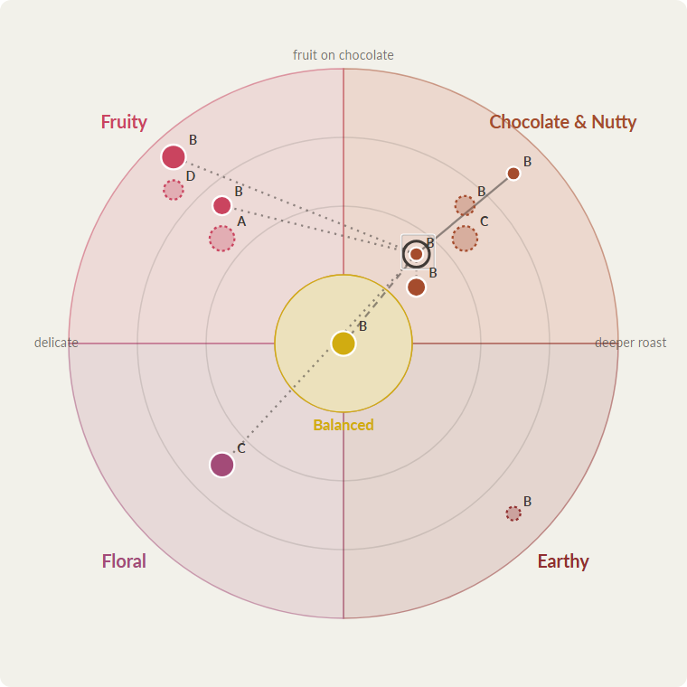
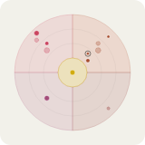

# Closing report — Ella's Bloom Map 2: Workbench

Brief: `CLAUDE_CODE_PROMPT_ELLA_MAP_2_WORKBENCH.md` · Run 2026-11-10 · Test mode.

**Status: done in test mode.** Task 0 stopped once for Dana; her decisions of 2026-11-10 (below) were then built in one run. Deploy evidence is at the end.

## Before Task 0: test DB refreshed from prod (OT-121)

I ran `npm run test:db:refresh` with `CLOUDSDK_PYTHON=C:\Python313\python.exe`. It cloned `axisandbloom` into `axisandbloom_test` (dump `axisandbloom-2026-11-10T19-27-00-180Z.sql`, object deleted afterwards).
- **Before:** 102 coffees and 201 profiles (test fixtures included).
- **After:** 56 coffees, 15 slot assignments, 127 profiles. The Liam gate and eval seeds were already present.
- **Brief 9's data is there:** `cupping_score_dispute` has 1 row (dispute 1), the latest score id is 170, and Feminista's pooled Body is **5.85** (it was 6.77).
- The `dial_` seeds came over from prod: 25 parameters, the new grade D text, 0 versions and 0 lean decisions. Brief 1's `test-dry-run` draft is gone, as expected.
- OT-121 can close. OT-117 should be measured again on this copy in Part D.

## Task 0 findings

### 1. Brief 1's API as built

All routes are under `/api/admin/map`, behind `admin.ts`'s `requireAdmin`. I read the shapes from `dialReads` on the refreshed test DB.

**Reads.** Every value is a **code**, not a label, unless named otherwise.

| Route | Shape |
|---|---|
| `GET /preview` | 12 rows. See the field list below the table |
| `GET /placement` | The same, over the active version: `placement_id`, `version_id`, `version_label`, `coffee_is_active`, `is_sellable_at_cut`. 0 rows today |
| `GET /edges?mode=preview\|active` | `from_coffee_id`, `to_coffee_id`, `from_archetype`, `to_archetype`, `relation` (dial_move code), `distance`, `delta_ring` / `_body` / `_sweetness` / `_acidity` / `_bitterness` (signed, to − from), `adjacency_rank`, `to_grade_rank`, `to_in_stock`, `to_category_codes`. 42 rows in preview |
| `GET /hops?mode=&coffeeId=` | The edge fields plus `rank`, `in_hop_set`, `within_cap`, `from_coffee_name`, `to_coffee_name`. Every eligible target is ranked |
| `GET /face` | `version_id`, `coffee_id`, `coffee_name`, `archetype_code`, `is_center`, `ring`, `lane_code`, `size`, `is_sellable`, `in_stock`, `category_codes`, `grade_code`. **Active version only**; no preview face |
| `GET /versions` | `id`, `label`, `status` (code), `reason`, `parameters` (key → number), `cut_by`, `cut_at`, `activated_at`, `retired_at`, `n_placements`, `ring_cuts` [{ring, lo, hi}], `size_cuts` [{size, lo, hi}] |
| `GET /wedges` | `{ wedges, seams }`. `wedges`: `archetype_code`, `archetype_name` (label), `is_center`, `angle_order`, `ruler_dimension_id`, `ruler_dimension_name` (label), `side_a_archetype`, `side_b_archetype`, `seam_family`, `seam_uses_body`, `seam_uses_dark_roast`. `seams`: `archetype_a`, `archetype_b`, `label`, `is_labelled` |
| `GET /first-match` | `archetype_code`, `lane_code`, `coffee_id`, `coffee_name`, `status` (code), `notes`, `decided_by`, `created_at`, `preview_grade`, `active_grade`, `min_grade_rank`, `meets_grade_floor_preview`, `meets_grade_floor_active` |
| `GET /phrases` | `{ rows, resolved }`. `rows`: the current `dial_hop_phrase` rows with `move_code`. `resolved`: 20 rows (5 families × 4 customer moves) with `button_label`, `move_line_template`, `edge_phrase`, `is_override` |
| `GET /graph-check?mode=` | `mode`, `parameters`, `centers`, `sellable` (count), `reachable`, `unreachableSellable`, `reachableWithoutTagged`, `noBolder`, `noGentler`, `noDifferent`, `noLiveDirection` (coffee **names**), `cousins` [{a, b, aToB, bToA, reproduced}] |

`GET /preview` fields:
- Identity and placement: `coffee_id`, `coffee_name`, `roaster_id`, `roaster_name`, `archetype_code`, `wedge_id`, `is_center`, `is_placeable`, `ring`, `size`.
- Readings: `ruler_dimension_id`, `ruler_value`, `acidity`, `bitterness`, `body`, `sweetness`.
- Lean: `lane_id`, `lane_code`, `lean_assignment_id`, `decided_lane_code`, `suggested_lane_id`, `suggested_lane_code`, `suggested_scores` {side_a / side_b: archetype, score, words, body; inputs}.
- Grade: `grade_id`, `grade_code`, `grade_rank`, `n_sessions`, `n_cuppers`, `n_sessions_pooled`.
- Availability and roast: `is_sellable`, `in_stock`, `category_codes`, `roast_level`, `is_dark`.
- Flags and inputs: `flags` (codes), `inputs_used` {pooled, ruler, words, roast, grade, sellable, lean}.

**Today's preview graph check** (refreshed DB): 7 sellable, 7 reachable. No bolder: Benchmark, Blossom, Feminista and La Familia. Cousins reproduced: 3 of 5, the same as brief 1.

**Writes:**

| Route | Body | Answers |
|---|---|---|
| `PATCH /lean/:coffeeId` | `{ lane: side_a\|middle\|side_b, basis?: object, notes?: string }` | `{ result: { coffeeId, unchanged, leanAssignmentId }, warnings: [], integrity: [] }` |
| `POST /versions` | `{ label (1–60), reason? }` | 201 when created, 200 when the label exists: `{ versionId, label, created, placements }` |
| `POST /versions/:id/activate` | — | `{ versionId, retiredVersionId }` |
| `PUT /first-match` | `{ archetype, lane, coffeeId, status?: founder_pick\|derived, notes? }` | `{ id, unchanged, supersededId? }` |
| `PUT /phrases` | `{ archetype \| null, move: stay\|bolder\|gentler\|different, buttonLabel, moveLineTemplate?, edgePhrase? }` | `{ id, unchanged, supersededId? }` |
| `PATCH /wedges/:archetype` | partial wedge fields (strict) | the row |

Error codes:
- **400**
  - zod: `{ error: 'Invalid input', issues }`
  - `DIAL_MAP_INVALID`: unknown lane, move or status; not a map family; missing or misordered cut parameters
  - `INVALID_INPUT` (CatalogError): unknown lane in setLean; a basis that is not an object
- **404:** `VERSION_NOT_FOUND`, `COFFEE_NOT_FOUND` (inactive coffee in setFirstMatch, or an unknown coffee in setLean), `WEDGE_NOT_FOUND`
- **409:** `VERSION_NOT_DRAFT`

**Gaps for this page.** Brief 2's Part A/B allows adding missing reads. Items (f) and (g) need you.
- **(a) No vocabulary read.** The page must show lane, grade, move and status labels and the grade descriptions (C3, G4.2), but no route returns `dial_lane`, `dial_evidence_grade`, `dial_move` or the status lookups. I would add `GET /map/vocabulary` via `dialReads.vocabulary()`.
- **(b) No lean history.** The acceptance item "superseded row visible in the row's history" has no read. I would add `dialReads.leanHistory(coffeeId)` and `GET /map/lean/:coffeeId/history`, over `coffee_lean_assignment`, with no new view: it would be the table's one read path. Or I add `v_coffee_lean_assignment` if you prefer the view-per-table rule (G2.5); that needs `comments.sql` and `catalog:md`.
- **(c) No preview face.** `v_dial_face` is active-only. In Preview mode the page draws from `GET /preview` (it carries every face field), so I would add no new view. Say if you want a `v_dial_face_preview` for symmetry.
- **(d) First match is not refused under the grade floor.** Brief 2 says "a coffee under the grade floor is refused by the API and the message shown". Brief 1's `setFirstMatch` only reports the floor at read time (`meets_grade_floor_*`), as Rev 3 section 8 says ("adds the grade floor check at read time"). Making the API refuse means `setFirstMatchInTx` rejects when the coffee's preview `grade_rank < param('dial_min_grade_rank_first_match')` (409 `BELOW_GRADE_FLOOR`). That changes the writer's behaviour. **Contradiction between the brief and Rev 3; your call.**
- **(e) Ring and size words.** The legend wants "three dot sizes with the words from the API's size labels", but **no size vocabulary exists**: `dial_placement.size` is just 1 to 3. No ring labels exist either. Adding them needs a `dial_size` lookup (and `dial_ring`, if the face labels rings), seeded with words I would have to invent. **Your words needed** (proposal: size 1 "less sweet", 2 "sweet", 3 "very sweet"; or leave the legend numeric for the admin page and let brief 3 bring customer words).
- **(f) Flag labels.** Flags are codes (`ruler_near_cut`, `no_family_word`, …). Readable chips without typing text in the frontend need a `dial_flag` lookup (code, label, description), seeded with brief 1's 11 flag codes. The preview view already emits the codes. **Your call:** add the lookup, or show the codes as they are (admin only).
- **(g) The live phrase example has no words for the deltas.** "Bolder than Tiger Stripe: darker roast, more body" needs words for each delta ("more body", "darker roast", "brighter"). The API gives only signed numbers, and nothing in the DB holds those words; typing them in the frontend would break G2.1/G4.2. This is also brief 3's move line. **Needs a decision:** a `dial_delta_phrase` lookup (reading × direction → words, plus a minimum-delta parameter, for example `dial_delta_phrase_min` 1.0) seeded with neutral words you approve; or this brief's example shows the template with the raw deltas ("Bolder than Tiger Stripe: body +1.4, bitterness +3.3") and brief 3 brings the words.

### 2. `AdminLayout.tsx` nav
- "Catalogue & Supply" lists Roasteries, Roastery Feedback, Coffees, Blends & SKUs and **Bloom Dial** (`/admin/dial`, line 20).
- I'll add `{ to: '/admin/map', label: "Ella's Bloom Map" }` right after it, and the route `<Route path="map" …>` beside `path="dial"` (`App.tsx:150`).
- The old entry stays.

### 3. Patterns to reuse
- **`AdminCalibrationWorkbench.tsx`:**
  - A decision is a card: `CardTitle` (eyebrow plus the current value), a form that starts from the current catalog value, a basis text the user must give (`RuleInput`, with an amber "required" band when the decision is not what every source said), `Warnings`, and `SubmitRow` with the reason a submit is disabled.
  - Writes go through `lib/catalogWrites.ts` (`call(apiFetch, url, init)` with JSON).
  - For the lean I'll follow the same card shape inline on the row: three lane buttons with the suggestion marked, a required basis text, Save. I'll add `setLean(apiFetch, coffeeId, body)` to `lib/catalogWrites.ts` (the lean is a catalog decision).
  - The **workbench opens a roastery, not a coffee**: `/admin/roastery-portal?roastery=<id>&view=workbench`, with the coffee chosen in-page (state). The family link can open the right roastery's workbench but cannot preselect the coffee unless I add a `coffee=` param to the workbench (one prop). I propose adding it.
- **`EvidenceParametersCard.tsx`:**
  - Props are `title`, `endpoint` (GET the list, PUT `${endpoint}/${key}`), `intro`, `footer`, `testId`.
  - It has **no prefix and no on-save callback**. CTO call 4 needs both: I'll add `prefix?: string` (appended to the GET only) and `onSaved?: () => void`. The other call sites stay unchanged.
- **`bloomVisuals.ts`:** `ARCHETYPE_VISUALS[code].color` (floral #a34b78, fruity #ca445f, balanced_sweet #d1ac11, chocolate_nutty #a54c2d, earthy #912f2f), `.tint`, `.plateInk`. These are brand design tokens already in the frontend; the face takes its colours from here.
- **`LookupSelect`:** a `lookup_value` dropdown (`category`, `lookups` map). The map's vocabularies are `dial_*` tables, not `lookup_value`, so it does not fit the lane control. I'll use plain buttons fed from `/map/vocabulary` (gap a), and no new shared component.
- **`useArchetypes`:** `GET /api/admin/catalog/archetypes` through a module cache. It gives `label`, `sort_order` and `is_archetype`, so family names on the page come from here, or from `wedges.archetype_name`.

### 4. `BloomDial.tsx`
- It is a canvas "coloring-book" fill engine (`fillEngine.ts`, 1200 × 1200, `BEIGE` [242, 241, 234]) with rotate and drag machinery (`rotateTo`, wheel and bar drag).
- **Reusable as tokens only:** the beige paper background (`BEIGE`), the archetype colour from `config.color` (the same `ARCHETYPE_VISUALS` colours) and Lato (`styles/fonts.css`).
- Nothing of its geometry, rotation or drag code is reused, as the brief says.

### 5. Production (read-only)
`v_dial_placement_preview`: 12 rows, all placeable, 7 sellable. `dial_map_version`: 0 rows, none active. `coffee_lean_assignment`: 0 rows.

## Where Task 0 contradicted the brief (as reported, before Dana's decisions)
1. **(d)** Should `PUT /map/first-match` refuse a coffee under the grade floor? The brief says yes; Rev 3 section 8 and brief 1 check it at read time. My recommendation is yes: refuse with 409 and show the message.
2. **(e)** There are no size or ring words in the DB. Seed a `dial_size` lookup with words you give me, or keep the admin legend numeric (size 1 to 3).
3. **(f)** Flag chips: add a `dial_flag` lookup with labels, or show the codes.
4. **(g)** Delta words for the move line: a `dial_delta_phrase` lookup now (with your words), or this brief's example shows raw deltas and brief 3 decides the words.
5. **(a, b)** I'm going ahead unless you say otherwise. Two reads to add: `GET /map/vocabulary` and the lean history (route over the table, or a new `v_coffee_lean_assignment`).
6. **The rest** I'm going ahead with unless you say otherwise: `coffee=` on the Calibration workbench link, and `prefix` / `onSaved` props on `EvidenceParametersCard`.

## Dana's decisions after Task 0 (2026-11-10)
1. **First match:** refused at write under the grade floor (409, the message shown on the page), and the read check from brief 1 stays, because a grade can drop after a row was written.
2. **Size and ring words:**
   - `dial_size`: 1 "less sweet", 2 "sweet", 3 "sweeter" (`customer_label` the same).
   - `dial_ring`: 0 "the base", 1 "one step out", 2 "two steps out", 3 "the edge". `customer_label` stays NULL: customers never see ring words.
3. **Flag chips:** a `dial_flag` lookup seeded with every flag code brief 1 emits. A code with no row shows raw on the page and is reported by boot check 9.
4. **Delta words:**
   - `dial_delta_phrase` (reading × direction, supersede), seeded: acidity brighter / softer, bitterness more bite / less bite, body more body / lighter, sweetness a touch sweeter / a touch drier.
   - Parameter `dial_delta_min_to_mention` 1.0.
   - A move line lists the mentioned deltas in `dial_reading` order, comma-joined, through the `dial_hop_phrase` template.
   - The ring is carried by the move word; there are no roast words.
5. **Confirmed:**
   - `GET /map/vocabulary`.
   - The lean history through a view, `v_coffee_lean_assignment_history`.
   - `coffee=` on the Calibration workbench.
   - `prefix` and `onSaved` on `EvidenceParametersCard`.
   - OT-121 closes; OT-117 is re-measured below.

## What was built

### Part A — Schema
Additive and idempotent, at the end of the Ella block in `schema.sql`. Every object has its `comments.sql` lines.
- **Lookups:** `dial_size`, `dial_ring`, `dial_flag` (11 rows), `dial_delta_direction` (up / down with a sign), and `dial_delta_phrase` (8 seeded rows; partial unique current; the request pool keeps only the `superseded_at` UPDATE). `dial_delta_direction` is my addition: "up | down" as a lookup rather than a CHECK list (G2.7).
- **Parameter:** `dial_delta_min_to_mention` 1.0 (`Range: numeric 0 <= value <= 15.`).
- **View:** `v_coffee_lean_assignment_history` (pre-dropped with the map views), now the table's one read path in `comments.sql`.
- **`dial_hop_rows`** (and so `v_dial_hop_preview` / `v_dial_hop`) now carries `from_archetype`, so the move line can take the from-family's template. The function is pre-dropped every boot, so the signature change is safe.

### Part B — Backend
- **`dialReads`:**
  - `vocabulary()`: lanes, grades, moves, version and first-match statuses, sizes, rings, flags, readings, delta phrases.
  - `leanHistory(coffeeId)`.
  - `moveLineContext()` and the pure `composeMoveLine(ctx, hop)`.
  - `hopsPreview` / `hops` rows now carry `move_line` and `deltas_mentioned` [{reading, delta, phrase}].
- **`dialPlacementService.setFirstMatchInTx`** refuses a coffee whose preview grade rank is under `dial_min_grade_rank_first_match` with 409 `BELOW_GRADE_FLOOR`. The message names the coffee, its grade and the floor grade; a coffee with no placement is refused the same way.
- **Routes:** `GET /api/admin/map/vocabulary` and `GET /api/admin/map/lean/:coffeeId/history`.
- **`dataCatalogIntegrity` check 9** also covers the size, ring and delta-direction codes, one current delta phrase per reading × direction, and every flag code in the preview having a `dial_flag` row. Check 10 lists 26 keys.

### Part C — Frontend
- **`components/bloom/map/`:**
  - `mapGeometry.ts`: quadrants by `angle_order`, shared boundaries, lane angles (`LANE_INSET` 0.2 of the span from the seam), equal rings, the center's lean point, dot radius by size, a deterministic fan-out by `coffee_id`.
  - `EllaMapFace.tsx`: one SVG, tap only (click, or Enter / Space on a focused dot), no rotation or drag; brand colours from `bloomVisuals` on the dial's beige, Lato.
  - `EllaMapLegend.tsx`.
- **`admin/AdminEllaMap.tsx`** at `/admin/map`. The nav entry "Ella's Bloom Map" sits right after Bloom Dial, and the old entry stays. Its sections:
  - Mode toggle, with the active version's label, cut date, reason and parameter snapshot in Active mode.
  - Face (full, with grades). Tapping a dot highlights its row, scrolls to it, and opens the hops panel with a thumb face.
  - Placement table, with filters by family, flag, grade and sellable and four sorts. Not-placeable coffees are listed last.
  - Lean control (Preview only): lane buttons from the vocabulary with the suggestion marked ★, and a required basis. The basis JSON carries the text, the suggestion and the scores.
  - Row details: `inputs_used` and the lean history.
  - Parameters (`EvidenceParametersCard`, `prefix="dial_"`; `onSaved` re-fetches).
  - Hops: per move the in-set targets with distance, adjacency, the five deltas and the move line. The edge state shows the family's edge phrase.
  - Graph check: red when a sellable coffee at or above the hop-target floor is unreachable. Cousins show both directions.
  - First match: the table with a "below grade" chip when the read check fails, and a form that shows the API's message.
  - Phrases: default and per-family rows, editable, with a live example from a real hop.
  - Versions: Cut in Preview only; Activate with a confirmation that names what changes.
- **`lib/mapAdmin.ts`** (the map calls) and `catalogWrites.setLean`.
- **`EvidenceParametersCard`:** `prefix` (appended to the GET only) and `onSaved`; the other call sites are unchanged.
- **`AdminCalibrationWorkbench`:** `initialCoffeeId`, fed by `&coffee=<id>` in `AdminRoasteryPortal`.

### Part D — Tests
- **Backend:**
  - `dialMap.test.ts`: 3 new cases (`composeMoveLine`: minimum, order, no dangling colon, sibling null; the vocabulary and context, with every emitted flag having a row; hops carry `move_line`; the lean history shows the superseded row; first match refused under the floor and accepted at B).
  - `mapAdmin.test.ts`: 1 new case (vocabulary keys, the history route and its 400).
  - All 29 map, route, integrity and comment-format tests pass.
- **Frontend:** `mapGeometry.test.ts` (5: angle per wedge and shared boundaries, lane offsets toward each seam, equal rings, fan-out independent of row order, no ring means no dot). The full frontend suite passes, 150 tests.
- **Type-check:**
  - Backend `tsc` is clean.
  - Frontend `tsc` shows the 7 known pre-existing errors (ArchetypeSection, useAdjacentArchetype, Profile), none in this brief's files.
- **Lints:** all six are clean.
- **OT-117 re-measured on the refreshed test DB** (`npx vitest run src`, so no `dist/` copies): **22 failed / 1194 passed / 6 skipped in 103 files.** They are the same 22 in the same 10 files as the brief 9 baseline: evidenceViews 6, quizScoring 6, evidenceAdmin 3, sommelierEval 2, sommelierRag 2, sommelierAnswer 1, catalogService 1, schema.catalog_blueprint 1, lintCustomer 1, and qrDoor's cleanup FK. None are map code.

## Acceptance (local, signed in as admin, test DB)
The admin was a marked test user, "Zzz Test Admin (Ella map 2)" (Firebase uid `Ucnqh9cC…`, admin `user_profile` row in the test DB only). It was demoted and its Firebase user disabled afterwards. `/api/users/profile` was stubbed in the browser only, as in earlier briefs. The frontend ran on Vite :5173, with the backend on :4917 against the test DB. The runs used Playwright (`backend/tmp/em2_ui.mjs`).

- **The page renders every catalog coffee,** with lane, ring, size, grade and flag words from the vocabulary, and the nav entry is present. The nine Joe coffees show the cells brief 1 listed:
  - Benchmark: 0 · the base · B, suggests side A chocolate 0.72.
  - Tiger Stripe: 1 · B.
  - Fabricator: 1 · B · near a ring cut.
  - Blossom: 3 · B.
  - Geometric: 2 · A · not sellable.
  - The Village: 2 · B, suggests floral.
  - Feminista: 3 · B, chocolate **0.66** (prod values, after the refresh).
  - Nightcap: 3 · D · 0 / 0 · provisional.
  - La Familia: 2 · C · no family word.
- **Lean on Fabricator** (middle; saved twice so there is a superseded row):
  - The row showed "Middle of the wedge" at once, with "Suggestion differs" in place of "No lean decision".
  - The other eight Joe rows' text is byte-identical before and after.
  - The history shows two rows, newest current and the earlier one struck through.
- **Parameters:** `dial_ring_cut_1` 4 → 3.7 on the card moved Fabricator to ring 2 in Preview, while Active mode kept ring 1 (`test-wb-1`). It was set back to 4 afterwards; the three rows (4, 3.7, 4) stay in `evidence_parameter`, superseded as designed.
- **Graph check** on the page: 7 of 7 sellable reachable from Benchmark. No bolder: Benchmark, Blossom, Feminista and La Familia. Cousins: 3 of 5 reproduced. This equals `dialReads.graphCheck` in brief 1's report.
- **Versions:** `test-wb-1` was cut through the page ("Cut test-wb-1: 12 placements, a draft."). The confirmation read "test-wb-1 becomes the active version."; it was activated, and Active mode shows it. It is **left active on the test DB only**; production has no version.
- **First match:** La Familia (grade C) as floral × side A is refused, and the page shows "Colombia La Familia Guarnizo is grade C; a first match needs grade B or better (dial_min_grade_rank_first_match)".
- **Live phrase example:** "A different direction from Benchmark: brighter, a touch drier, more bite, more body".
- **Tiger Stripe's hops:**
  - Bolder: Blossom, "Bolder than Tiger Stripe Espresso: softer, more bite, more body".
  - Gentler: Benchmark.
  - Different: The Village, Feminista, La Familia.
  - Sibling: Fabricator.

**Screenshots** (this folder):
- `map2_face_full.png`: the full face, Tiger Stripe selected with its hop lines.
- `map2_face_thumb.png`: the thumb face, 160 px.
- `map2_fabricator_row.png`: Fabricator's row after the lean.

 

## Deviations
1. **`EllaMapFace` takes `wedges` and `seams` props** beside CTO call 1's list: the geometry needs `angle_order` and the sides, and the seam labels need `dial_seam`. Both come from `GET /map/wedges`.
2. **`dial_delta_direction`** is a lookup rather than a CHECK on "up | down" (G2.7).
3. **The center's lane** is drawn as a point toward its lean-side wedge, half-way out in the disc; middle is the exact center. A single wedge cell fans out by `coffee_id` around the cell point.
4. **The thumb face** sits in the hops panel, so the `thumb` size is used on the page (and screenshotted).
5. **A move line with no delta above the minimum** drops its trailing ": " ("Bolder than A").

## What brief 3 needs
- **Face:** `EllaMapFace` props as built: `{ placements: FacePlacement[] (coffee_id, coffee_name, archetype_code, is_center, ring, lane_code, size, is_sellable), wedges: FaceWedge[] (archetype_code, archetype_name?, is_center, angle_order, side_a_archetype, side_b_archetype), seams?: FaceSeam[], highlightCoffeeId?, hops?: { to_coffee_id, relation }[], size: 'thumb' | 'full', labelMode?: 'name' | 'none', onTapCoffee? }`. The face never draws grades. Customer use: pass customer names in `coffee_name`, or `labelMode="none"`. `EllaMapLegend` takes `customer` to use `customer_label`.
- **Move lines:** `composeMoveLine(ctx, { fromArchetype, relation, fromName, toName, deltas })` with `moveLineContext()`. Brief 3's customer names (slot or category names, roaster-blind) are passed as `fromName` / `toName`. Hop rows already carry `move_line` built from catalog names; the customer API should recompose it with customer names.
- **Words:** `vocabulary()` gives sizes (`customer_label`), the delta phrases and the moves. Rings have no customer words by design.
- **Data:**
  - Production has no version and no lean decision.
  - The test DB has `test-wb-1` active (12 placements, with Fabricator's middle lean recorded after the cut).
  - First match: only the Benchmark seed.
- **OT-123** (long lane labels) is for Dana's words before customers see any lane-derived text.

## After review (Dana 2026-11-10): lane words per wedge (OT-123 closed)
- **The template:** `dial_lane.label` is now a template: "Leans {side}" for side_a and side_b, "Middle" for middle.
  - The seed inserts the template when a row is missing.
  - A guarded one-time `UPDATE` moves rows that still carry brief 1's text ("Leans to the wedge on side A/B", "Middle of the wedge") and touches nothing else.
- **Resolved by the API:** `GET /map/vocabulary` adds `laneWords` [{archetype_code, lane_code, label}], with `{side}` resolved per wedge through `dial_wedge`'s side archetype and `coffee_archetype.name`. For Chocolate & Nutty that gives "Leans Fruity", "Middle", "Leans Earthy".
- **The page uses the resolved words everywhere a lane appears:** the lane buttons, the row's lane and suggestion, the history, the hops panel, the first-match table and form. Nothing is typed in.
- **Tests:** `dialMap.test.ts` asserts the resolved words for Chocolate & Nutty and that no `{side}` is left; `mapAdmin.test.ts` expects the `laneWords` key. All 29 pass, the frontend has 150 passing, the lints are clean, and frontend `tsc` still shows only the 7 known errors.

## Deploy
- **Commits:** `98180c7` (the brief) and `ee8122b` (lane words per wedge, OT-123), pushed to `main` 2026-11-10 by path. The genova `.ttf` deletions and `commerce/README.md` stayed unstaged.
- **Deploy run 42896805012:** green (backend and frontend). Revision `axis-bloom-backend-00853-92t`.
- **Startup log:**
  - `[db-comments] applied 1954 statements`.
  - `[data-catalog] report only: 192 tables, 98 views, 1664 columns; 2 of 10 checks with findings`.
  - Checks 7 to 10 pass: one active version or none, placements on active coffees, every map seed present (now including sizes, rings, delta directions, a delta phrase per reading × direction, and a `dial_flag` row for every emitted flag), and all 26 `dial_` keys.
  - The two findings are #4 (CATALOG.md stale, expected before the regenerate below) and #6 (the same 25 dead-table candidates as before, none `dial_`).
  - No ERROR lines.
- **Seeds on prod (read-only check):**
  - Lookups: `dial_size` 3, `dial_ring` 4, `dial_flag` 11, `dial_delta_direction` 2, current `dial_delta_phrase` 8.
  - Parameters: 26 `dial_` parameters (`dial_delta_min_to_mention` added).
  - `dial_lane` labels moved to "Leans {side}" / "Middle" by the guarded update.
  - 0 versions and 0 lean decisions, so production was written only by the boot seeds.
- **`npm run catalog:md -- --expect-db axisandbloom`** from prod: catalog-hash `c4886970949a…`, equal to the live hash in the startup log. Committed with this section.
