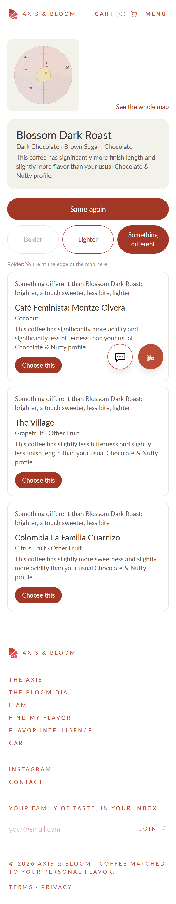
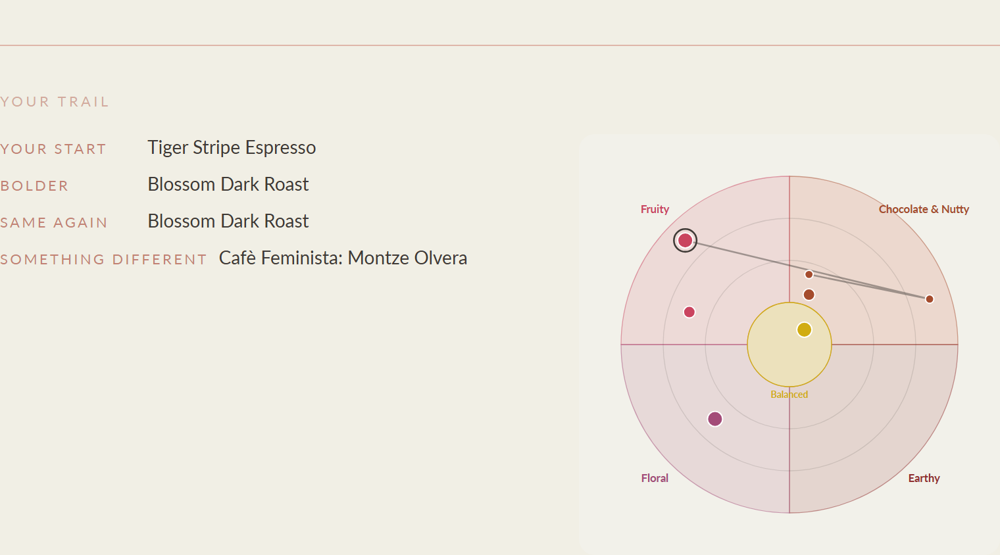

# Closing report: Ella's Bloom Map 3, match service and customer surfaces

- **Brief:** `CLAUDE_CODE_PROMPT_ELLA_MAP_3_MATCH_AND_CUSTOMER.md`, written 2026-11-12.
- **Runs:**
  - The first run on 2026-11-12 stopped at the gate, because production had no map version.
  - Dana then cut and activated version 1, so this run passes the gate.
- **Mode:** test. Every `dial_surface` row will stay `lane`.

**Status: built and accepted in test mode after Dana's decisions of 2026-11-12 (Task 0 below; the seven questions it raised are answered in "Dana's decisions after Task 0").** Every `dial_surface` row is `lane`; `/map` is admin-only.

---

## Pre-step (Dana 2026-11-12): button labels per family in `dial_hop_phrase`

**Dana's words:**
- chocolate_nutty: bolder "Bolder", gentler "Lighter".
- earthy: bolder "Stronger", gentler "Lighter".
- fruity and floral: bolder "Brighter", gentler "More delicate".
- balanced_sweet: bolder "Bolder".
- "Something different" stays everywhere; the move line templates are unchanged.

**How it was written:**
- Through `dialPlacementService.setHopPhraseInTx`, the table's one writer. Each pair is supersede-only: the old row gets `superseded_at`, and a new row is inserted.
- The script is a one-off, `backend/tmp/em3_labels.mts test|prod` (gitignored).
- **Guard:** a pair is written only when its current resolved label is a brief 1 seed label ("Bolder", "Brighter", "Gentler", "Softer") or already the target. Any other label would have been skipped and reported; none was.
- **Carried over:** each row keeps its existing `move_line_template` and `edge_phrase`. Both were NULL on every family row, so the default templates still apply.
- **decided_by:** `dana-2026-11-12 (ella map 3 pre-step)`.
- **Database check:** the script checks it is on the intended database: `axisandbloom_test` first, then `axisandbloom`.
- **Idempotent:** a second run on the test DB returned "unchanged" for all 9 pairs.

| Family × move | Before (production) | After | Production row |
|---|---|---|---|
| chocolate_nutty bolder | Bolder (default) | Bolder | new 11 |
| chocolate_nutty gentler | Lighter (Dana on the workbench, 2026-11-12 18:15) | Lighter | unchanged 9 |
| earthy bolder | Stronger (Dana on the workbench, 2026-11-12 18:16) | Stronger | unchanged 10 |
| earthy gentler | Gentler (default) | Lighter | new 12 |
| fruity bolder | Brighter (seed) | Brighter | unchanged 3 |
| fruity gentler | Softer (seed) | More delicate | new 13, supersedes 6 |
| floral bolder | Brighter (seed) | Brighter | unchanged 2 |
| floral gentler | Softer (seed) | More delicate | new 14, supersedes 5 |
| balanced_sweet bolder | Bolder (default) | Bolder | new 15 |

- **Test DB:** the same 9 pairs. Rows 9 to 15 are new there, because the workbench edits were never made on test.
- **"different":** no current row on either database has a label other than "Something different".
- **Production resolution afterwards** (`dialReads.phrases`):
  - balanced_sweet: Bolder / Gentler (default; the center has no gentler move) / Something different.
  - chocolate_nutty: Bolder / Lighter / Something different.
  - fruity and floral: Brighter / More delicate / Something different.
  - earthy: Stronger / Lighter / Something different.
  - Same again everywhere.
- **A note on the move lines:** they still read "Gentler than {from}: …" under a "Lighter" or "More delicate" button, and "Bolder than {from}: …" under "Brighter" or "Stronger", because the templates were left as they are. The templates are per family × move too (R3.10), so this is one workbench edit away if wanted.

---

## Decisions already made: version 1 (production, read-only, 2026-11-12)

### The version
| id | label | status | cut_by | cut_at (UTC) | activated_at (UTC) | reason |
|---|---|---|---|---|---|---|
| 1 | **L0** | active | `cptmb666…` | 2026-11-12 18:17:01 | 2026-11-12 18:17:09 | "L0-test cut" |

It is the only version on production. **L0 is version 1** (Dana 2026-11-12, decision 9) and is recorded under that label.

### Parameter snapshot (`dial_map_version.parameters`)
All 26 are equal to the seed values. No `dial_` parameter has ever been superseded on production.

| key | value | key | value |
|---|---|---|---|
| dial_ring_cut_1 | 4 | dial_ring_cut_2 | 6.5 |
| dial_size_cut_1 | 4.5 | dial_size_cut_2 | 6.5 |
| dial_w_ring | 1 | dial_w_lane | 0.5 |
| dial_w_body | 0.15 | dial_w_sweet | 0.1 |
| dial_cap_different | 3 | dial_delta_min_to_mention | 1 |
| dial_min_grade_rank_first_match | 3 (B) | dial_min_grade_rank_hop_target | 2 (C) |
| dial_grade_sessions_for_a | 3 | dial_grade_cuppers_for_a | 2 |
| dial_grade_sessions_for_b | 2 | dial_grade_cuppers_for_b | 2 |
| dial_cut_margin_flag | 0.25 | dial_lean_promotion_n | 12 |
| dial_suggest_threshold | 0.25 | dial_suggest_w_body | 0.3 |
| dial_suggest_w_words | 0.5 | dial_suggest_word_pos1 | 1 |
| dial_suggest_word_later | 0.5 | dial_suggest_body_cut_base | 6 |
| dial_suggest_body_cut_light | 4 | dial_suggest_dark_roast_add | 0.5 |

### Cuts
| Ring | lo | hi | | Size | lo | hi |
|---|---|---|---|---|---|---|
| 1 | | 4 | | 1 | | 4.5 |
| 2 | 4 | 6.5 | | 2 | 4.5 | 6.5 |
| 3 | 6.5 | | | 3 | 6.5 | |

### Lean decisions (current `coffee_lean_assignment`)
There are 8 rows, none superseded. La Familia's was added on 2026-11-12; the other seven date from 2026-11-10.

| Coffee (id) | Lane | Suggested | Basis text |
|---|---|---|---|
| Cafè Feminista: Montze Olvera (2902) | middle | side_a | roaster feedback notes;claude feedback |
| Colombia La Familia Guarnizo (2903) | middle | side_a | roastery description. (2026-11-12) |
| The Village (2904) | side_b | side_b | roaster feedback notes; claude feedback |
| Benchmark (2905) | side_a | side_a | roaster feedback notes |
| Tiger Stripe Espresso (2914) | side_a | side_a | roaster feedback notes |
| Geometric Filter Coffee (2915) | side_a | side_a | roaster feedback notes |
| Blossom Dark Roast (2916) | side_b | middle | roaster feedback notes |
| Fabricator House Roast (2917) | side_a | side_a | roaster feedback notes; cupping notes |

All eight were decided by `cptmb666…`. The `basis` JSON (text, `decided_on`, suggestion and both side scores) is on each row.

### First match (`dial_first_match`)
There is one row: balanced_sweet × side_a → Benchmark, `founder_pick`, the brief 1 seed. No other family has one.

### Placements in L0 (`v_dial_placement`, 12 rows; 13 active coffees)
| Coffee | Family | Ring | Lane | Size | Grade | Sellable | In stock | Tags | Flags |
|---|---|---|---|---|---|---|---|---|---|
| Benchmark | balanced_sweet (center) | 0 | side_a | 3 | B | yes | yes | | |
| Tiger Stripe Espresso | chocolate_nutty | 1 | side_a | 1 | B | yes | yes | | |
| Fabricator House Roast | chocolate_nutty | 1 | side_a | 2 | B | yes | yes | | ruler_near_cut |
| Amsterdam | chocolate_nutty | 2 | middle | 2 | B | no | yes | | no_lean_decision |
| The Daily | chocolate_nutty | 2 | middle | 3 | C | no | yes | | no_lean_decision |
| Blossom Dark Roast | chocolate_nutty | 3 | side_b | 1 | B | yes | yes | | suggestion_differs |
| The Village | fruity | 2 | side_b | 2 | B | yes | yes | | |
| Geometric Filter Coffee | fruity | 2 | side_a | 3 | A | no | yes | | |
| Cafè Feminista: Montze Olvera | fruity | 3 | middle | 3 | B | yes | yes | | suggestion_differs |
| Nightcap Decaf | fruity | 3 | middle | 2 | D | no | yes | decaf | no_family_word, no_lean_decision, provisional |
| Big City | earthy | 3 | middle | 1 | B | no | yes | | no_family_word, no_lean_decision |
| Colombia La Familia Guarnizo | floral | 2 | middle | 3 | C | yes | yes | | no_family_word, suggestion_differs |

**Summary:**
- 7 sellable: Benchmark, Tiger Stripe, Fabricator, Blossom, The Village, Feminista, La Familia.
- Earthy has no sellable coffee.
- Floral's only sellable coffee is grade C.

**Wedges (`dial_wedge`):**
- center: side_a chocolate_nutty, side_b fruity.
- chocolate_nutty: fruity / earthy.
- fruity: chocolate_nutty / floral.
- earthy: chocolate_nutty / floral.
- floral: fruity / earthy.

### Graph check (`dialReads.graphCheck('active')`, production)
- 7 of 7 sellable are reachable from Benchmark; 0 are unreachable.
- No bolder: Blossom, Feminista, La Familia.
- Every coffee has a gentler, a different and at least one live direction.
- Cousins: 3 of 5 reproduced.
  - Reproduced: Tiger Stripe → Blossom (bolder) and back (gentler); The Village ↔ La Familia (different); Feminista → The Village (gentler) and back (bolder).
  - Not reproduced: Geometric ↔ Fabricator, The Daily ↔ Benchmark. Geometric and The Daily are not sellable, so they are not points.
- `v_dial_hop` has 42 rows: bolder 6, gentler 9, different 25, sibling 2. The hop sets are:

| From | Bolder | Gentler | Different (cap 3) | Sibling |
|---|---|---|---|---|
| Benchmark | Fabricator | (edge) | La Familia, The Village, Feminista | |
| Tiger Stripe | Blossom | Benchmark | The Village, Feminista, La Familia | Fabricator |
| Fabricator | Blossom | Benchmark | The Village, Feminista, La Familia | Tiger Stripe |
| Blossom | (edge) | Tiger Stripe | Feminista, The Village, La Familia | |
| The Village | Feminista | Benchmark | La Familia, Blossom, Fabricator | |
| Feminista | (edge) | The Village | La Familia, Blossom, Fabricator | |
| La Familia | (edge) | Benchmark | The Village, Feminista, Fabricator | |

Example move line: "Bolder than Tiger Stripe Espresso: softer, more bite, more body".

---

## Task 0, items 2 to 10

### 2. Quiz door (`routes/quiz.ts POST /results`, line 158)
- **The call point:** `saveQuizSession` runs at 210-220 and returns `{ sessionId }`. The best-effort `withTransaction(tx => recordScoredInterpretation(...))` runs at 227-233 inside a try/catch. The decision call goes after 233 and before `if (proxy)` at 235, so it covers self and proxy quizzes.
- **The interpretation is not kept today.** `recordScoredInterpretation` returns `Interpretation | null` (`matchArchetype`, `intensityLean`, …; quizSession.ts:176-201), but the route discards it. Part B3 captures it; the alternative is re-reading `v_customer_quiz_current`.
- **Proxy quiz** (Household 2, lines 173-187):
  - `actorId = profileIdForUid(req.uid)`, then `assertMayQuizFor(actorId, forMemberId)` (householdService.ts:654) returns `ProxyTarget {memberId, householdId, userId, firebaseUid, firstName}`.
  - `profileId = proxy ? proxy.target.userId : own`.
  - The actor is stored in `quiz_session.taken_by_user_id` and in a `quiz_taken_for_member` household event.
- **Decaf:**
  - The quiz never really captures it. `FlavorQuiz.tsx:892` sends `decaf: false` always, stored in `quiz_session.context_data->>'decaf'`.
  - The customer's real decaf preference is the brew-profile field `decaf_constraint` (`v_customer_brew_profile`; `liamProfile.isDecafOnly()`, liamProfile.ts:535). See decision 1.
- **`match_archetype`, `intensity_lean`, `secondary_archetype`:**
  - They are archetype **names**, not codes: 'Balanced', 'Chocolate & Nutty', 'Fruity', 'Earthy', 'Floral'. They map through `coffee_archetype.name`, as `v_customer_quiz_current` already does: it returns `match_archetype_code` and `secondary_archetype_code`.
  - `intensity_lean` is 'delicate' or NULL (DB CHECK; TS type `'delicate' | null`, quizScoring.ts:94). There is no lookup.
  - The current row is the one with `is_current`; v2.2 is the version (`INTERPRETATION_VERSION`).
  - The brief's "Cozy" is the family named "Balanced", code `balanced_sweet`.

### 3. Identity
- **`v_customer_identity`** (schema.sql:6181): a recursive walk over `customer_identity_link`, skipping undone links, depth under 5. The deepest node is canonical; on a cycle, the oldest profile in the path wins. Output is `(user_id, canonical_user_id)`.
- **Folding pattern** to copy (`v_customer_dial_current`, 6434): `JOIN v_customer_identity vci ON vci.user_id = t.user_id`, then `DISTINCT ON (vci.canonical_user_id …) ORDER BY … DESC`. `v_household_member` (10200) left-joins `v_customer_identity`, then the current views on `canonical_user_id`.
- **`householdService.assertMayTurnDialFor` does not exist.** The check is the private `dialTarget(tx, actorUserId, memberId)` (householdService.ts:683), which throws `HouseholdError(400,'dial_for_self')` or `(403,'may_not_turn_dials')`. It is used by `memberDialPosition` and `turnDialFor` (which writes the old dial). See decision 6.

### 4. Brief 1 and 2 reads as built
- **`v_dial_hop`** columns: `from_coffee_id, to_coffee_id, from_archetype, relation, rank, in_hop_set, within_cap, distance, adjacency_rank, delta_ring/_body/_sweetness/_acidity/_bitterness, to_grade_rank, to_in_stock, to_category_codes`.
  - **The view does not carry the move line:** `dialReads.hops()` adds `from/to_coffee_name`, `move_line` and `deltas_mentioned` through `moveLineContext()` and `composeMoveLine()`. For customer names, `composeMoveLine(ctx, {fromArchetype, relation, fromName, toName, deltas})` is the reuse point.
  - **Edges exist only between two sellable points** (`dial_edge_rows`: `WHERE a.is_sellable AND b.is_sellable`). So the view already drops not-sellable targets, and a not-sellable *position* has no hops at all (decision 4). Out of stock and category tags are left to the service (`to_in_stock`, `to_category_codes`), as CTO call 5 wants.
- **`v_dial_placement`:**
  - It is the active version only, with these columns: `version_id, version_label, coffee_id, coffee_name, roaster_id, roaster_name, archetype_code, is_center, ring, lane_code, size`, the readings, `grade_code/rank, is_sellable, in_stock, category_codes, flags, inputs_used`.
  - **There is no view of placements in other versions.** CTO call 3's "most recent placement in any version" needs `dial_placement` itself, or a new view (decision 4).
- **`v_dial_face`:** version, coffee, family, center, ring, lane, size, sellable, in stock, tags and grade. It carries no wedges or seams; those come from `dialReads.wedges()`.
- **`dialReads`:**
  - placementPreview/Active, edgesPreview/edges, moveLineContext, composeMoveLine, vocabulary, leanHistory, hopsPreview/hops, face, versions, getVersion, wedges, firstMatches, phrases, parametersInForce, computeGraphCheck/graphCheck.
  - **Phrase resolution** per family is `dialReads.phrases().resolved` ({archetype_code, move_code, button_label, move_line_template, edge_phrase, is_override}): the family row when there is one, else the default.
- **`GET /api/admin/map/vocabulary`:** lanes, laneWords, grades, moves, versionStatuses, firstMatchStatuses, sizes, rings, flags, readings, deltaPhrases.
  - `dial_move` on production: quiz_result, stay, bolder, gentler, different, liam, sibling.
  - `is_customer_move` is set for stay, bolder, gentler and different.
- **`EllaMapFace` props:** `placements, wedges, seams?, highlightCoffeeId?, hops?, size, labelMode?, onTapCoffee?`. It draws no grades. `labelMode` defaults to names on the full face and none on the thumb.

### 5. Beats (the dial-in email)
- **Selection:** `beatEngine.selectBeats` (beatEngine.ts:85; dial-in rules 104-115). It skips inactive config, repeat coffee and degraded silence; the channel is email unless SMS is opted in; it is scheduled now + `timingOffsetDays`.
- **There is no template file:** the HTML is inline in `routes/cron.ts:235` `buildDialInEmail({firstName, alias, respondBase, talkLink})`, sent from `processDueDialInBeats()` (147-233).
- **The sender is not shared:** beats use cron.ts's own `new Resend(...)` (:21, `resend.emails.send` :204). The shared `sendResendEmail` (features/marketing/resendEmail.ts:67) exists but is not used here.
- **`beat_event`:** id, user_id, order_id, coffee_id, beat_type, channel, scheduled_at, sent_at, responded_at, skip_reason, respond_token (UNIQUE), created_at, updated_at; UNIQUE (user_id, order_id, beat_type).
- **Token:** `randomBytes(32)` hex, resolved by `resolveDialInBeatIdByRespondToken` (:247).
- **`GET /dial-in/:token/respond`** (beats.ts:28) accepts only `?expectation=lighter|as_expected|bolder`; anything else returns 400.
  - `respondToDialInBeat` writes `dial_position_signal` (`writeDialPositionSignal`) and, on lighter or bolder, adjusts the brew card's grind. It sets `responded_at`, and returns false when the beat is already answered.
  - It returns an HTML page (`renderResponsePage`).
  - Adding four links is one `<a>` each; the route needs a `move` branch (decision 5).

### 6. Profile
- **`components/Profile.tsx`:** the Flavor Memory tab (:447) has a single column (:476) with hairline separators (:553, 617, 643, 648, 654). `ActivityTimeline` sits in the two-up grid at :624-635 beside `TastingJournal`.
- **Data:** `GET /api/users/flavor-memory` (users.ts:620) → `customerReads.getTimeline` → `v_customer_timeline`.
- **Where "Your trail" goes:** a hairline and a block in the same column (after BrewCards :641-646, before `BrewProfileMirror` :652), reusing the micro-label header pattern of `ActivityTimeline.tsx:79`. The trail is not mixed into the timeline.

### 7. Quiz result screen (`FlavorQuiz.tsx`)
- **The two lines the brief names are not the dial.** Lines 1268 and 1636 are `WorthExploring matchArchetypeId=…`.
- **Where the result renders:** the result hero is `ResultScene` (:1565-1578; QuizScenes.tsx:196). "Your match" is the `qz-mhead` block (:1597-1603). The dial on the result is `DialArchetypeSection layout="field"` (:1606-1626), which renders `BloomDial`. `BloomDialWidget` is not rendered on this screen.
- **The sentence and the thumb fit** in the `qz-mhead` block, beside the name.
- **The results POST returns only `{ id }`** (or `{ id, forMemberId }`). The sentence and the thumb would come from `GET /api/map/me` after the submit.

### 8. Routing (`frontend/src/app/App.tsx`)
- **`/bloom`:** `<Route path="/bloom" element={<PrelaunchGate><BloomPage/></PrelaunchGate>} />` (:219), inside `PublicLayout`.
- **`AdminRoute`** redirects non-admins to "/". **`PRELAUNCH_OPEN_ROUTES`** is in `lib/prelaunch.ts:29`.
- **`/admin/map` exists** (:152); there is no top-level `/map`, so there is no collision.
- **`/map` goes next to `/bloom`:** `<Route path="/map" element={<PrelaunchGate><AdminRoute><MapPage/></AdminRoute></PrelaunchGate>} />`, following the `/checkout` nesting at :238.

### 9. Readers of `customer_liam_recommendation` (for brief 4; nothing changes here)
- **Writer:** `customerFacts.liamRecommendationFn` (live, via `liamWriteBack.recordTurn`) and `liamRecommendationBackfill`.
- **Views:** `v_customer_timeline` (6609), `v_palate_evidence` (7213), `v_palate_recommendation_outcome` (7402), `v_customer_calibration` (7447).
- **Direct code readers:**
  - `customerReads.getFactsWatermark` (:350), `getLastRecommendation` (:507), `getLiamHistory` (:581).
  - `scripts/backfillLiamRecommendations.ts:128`.
- **Through the views:** admin.ts:2143/2157, `customerReads.getRecommendationOutcomes` (:281), `scripts/exportCalibration.ts:36`, `customerIntegrity.ts:541/551`.

### 10. Production counts (read-only)
- **Current quiz interpretations:** v2.2 has 97, all with `match_archetype`, across 80 users; v1 has 51, with none, so no backfill (OPEN_TASKS at closing).
- **v2.2 by match family:**
  - Balanced 45 (secondary: Chocolate & Nutty 22, Fruity 15, none 8).
  - Chocolate & Nutty 21.
  - Earthy 12.
  - Fruity 13 (one of them delicate).
  - Floral 6 (all delicate).
  - Seven are delicate in all.
- **Not there yet:** `customer_match_decision`, `customer_match_candidate`, `dial_surface` and `dial_model` do not exist (0 decisions, as expected).
- **Household members:** 2, one household, both `may_turn_dials`.

---

## What the first-match rule (CTO call 4) gives on L0 today
The rule's words are taken literally; the fallback is a placed, sellable, in-stock coffee of the family at the lowest ring, grade ≥ B, most hops first.

| Quiz result (current v2.2 rows) | Cell asked | `dial_first_match` | Result |
|---|---|---|---|
| Balanced (45) | balanced_sweet × side_a | Benchmark (founder pick) | **Benchmark** |
| Chocolate & Nutty (21) | chocolate_nutty × middle | none | fallback: Tiger Stripe and Fabricator tie (ring 1, B, 6 hops each) → decision 3 |
| Earthy (12) | earthy × middle | none | fallback empty (Big City not sellable) → center → **Benchmark** |
| Fruity, not delicate (12) | fruity × side_a | none | fallback **The Village** (ring 2, B; Geometric not sellable). The fallback ignores the lane, and The Village is side_b |
| delicate (7: Floral 6, Fruity 1) | fruity × side_b | none | fallback **The Village** → decision 2 |
| Floral, not delicate (0 today) | floral × middle | none | fallback empty (La Familia is C) → **Benchmark** |

**R3.8 on L0:**
- From the center, every "different" target is fruity or floral (adjacency rank 1). The chocolate coffees are the center's *bolder*.
- So a Balanced customer whose secondary is Chocolate & Nutty (22 of 45) gets no reordering. A Fruity secondary (15) puts The Village and Feminista ahead of La Familia.
- This is noted, not a contradiction.

---

## Contradictions and decisions needed (Task 0's STOP; answered below)

1. **Decaf source.**
   - CTO call 5 says "a customer whose quiz says decaf". The quiz always sends `decaf: false`, so the filter would never be on.
   - Rev 3 section 4 says the filter comes from "`usual_drink` and the household record".
   - **Recommendation:** decaf-only = the brew profile's `decaf_constraint` (reuse `isDecafOnly`, read through `v_customer_brew_profile`), OR'd with the quiz `context_data.decaf` for when the quiz starts sending it. Record which source set it in `inputs`.
   - On L0 this changes nothing visible: Nightcap is the only decaf coffee and it is not sellable, so a decaf customer sees edge states everywhere.
2. **Delicate outside Fruity.**
   - CTO call 4: "`delicate` → the Fruity wedge's side toward Floral". On production 6 of the 7 delicate results are **Floral**.
   - **Recommendation:** apply it literally, so every delicate result goes to fruity × side_b (the Floral side). That is the cell the call names, and the Floral wedge has no B-grade coffee anyway. The alternative is floral × side_a (the Fruity side) for a Floral-delicate result.
3. **Fallback tie-break.**
   - "Most hops first" ties for Chocolate & Nutty (Tiger Stripe and Fabricator, 6 each).
   - **Recommendation:** after hops, prefer a coffee in the asked lane, then the lowest `coffee_id`, so the rule is deterministic. Today that gives Tiger Stripe.
   - Or set founder picks on the workbench for chocolate_nutty × middle and fruity × side_a/side_b. They are data, and the rule then never falls back for those cells.
4. **A position with no edges.**
   - Edges exist only between two sellable points, and only for coffees placed in the active version. So `moves()` has nothing to compute from in two cases:
     - (a) the position coffee is placed but no longer sellable;
     - (b) it is not in the active version (CTO call 3 / R3.7: "computed from its most recent placement in any version").
   - **Recommendation:** one new SQL function `dial_hop_rows_from(coffee_id)`. It takes the coffee's placement in the active version, or else its most recent placement in any version, as the *from* point, and runs it against the active version's sellable points. It reuses the same distance and relation rule, refactored into one shared SQL function so the rule still lives once.
   - The card shows the "no longer available" sentence. The substitute is the nearest same-family target (the sibling relation), as R3.7 says.
   - So that nothing is typed in, the sentence lives in a small new lookup, `dial_position_state` (`available`, `no_longer_available`), with a `customer_label` for the sentence.
5. **The dial-in email buttons when tapped.**
   - An email link carries the move but no coffee, and CTO call 6 requires a hop to name a coffee in the move set.
   - **Recommendation:** for `source beat`, the server picks the move set's rank-1 candidate at click time, after the filters, and records all candidates. The route gains a `move` query branch beside `expectation`, and `expectation` keeps its behaviour. A move tap does not set `responded_at` again.
   - The dial-in email is built inline in `cron.ts` with its own Resend client. The four links are added there, under the `reorder_email` row, and the sender is left as is.
6. **`assertMayTurnDialFor` does not exist.**
   - **Recommendation:** export the existing `dialTarget` check as `householdService.assertMayTurnDialFor(actorUserId, memberId)`. It is the same function, renamed and exported with its own transaction; `memberDialPosition` and `turnDialFor` keep calling it. This is reuse, not a fork.
7. **No price for map coffees outside slots.**
   - The 7 sellable map coffees have **no `coffee_retail_price` rows**. That table is, by its comment, for "category coffees with no dial slot", and it holds only 4 inactive coffees (Chocolate, Decaf, Hazelnut, Sleepwalker).
   - Their prices exist only in `coffee_slot_price`, read through `v_coffee_sellable_candidate`.
   - The cart's coffee-grain line (`DirectCartItem {coffeeId, weightOz}`) is priced by `cartResolver.retailPriceCents` from `coffee_retail_price`, so "add to cart" from `/map` would be refused as unavailable.
   - "Do not read a slot" (Do not, and README) and "price and add to cart through the existing cart components" (C1) cannot both hold on today's data. Options:
     - **(a)** Dana's prices go into `coffee_retail_price` for the map coffees (12 oz and the other sizes), written through `catalogService.setCoffeeRetailPrice`. It is a production data write, so it needs Dana's go and her numbers; copying the current slot prices is the obvious default. Note that `coffee_retail_price` also feeds `GET /api/coffees/other-categories` and the admin prices page, so a row can surface these coffees there; that has to be checked first.
     - **(b)** For brief 3 the card shows name, notes and compatibility, with no price and no cart button while no retail price exists, under a positive state line from the API. The test DB gets retail rows for acceptance only. The price move is a commerce decision for brief 4.
     - **(c)** The card reads the price through `v_dial_coffee_availability`, which already reads `v_coffee_sellable_candidate` for "sellable", and adds to cart as a dial (slot) line. That breaks "never read a slot".
   - **Recommendation:** (b) now, with (a) decided before brief 4 flips `customer_face`. README's slot finding already says the commerce move needs its own decision.

**Before Part A, also:** I recommend refreshing the test DB from production (the OT-121 pattern). The test DB's active version is `test-wb-1` (brief 2 acceptance); after the refresh, Part D and acceptance run on L0's real placements, leans and labels.

---

## Considered and not changed
- **CATALOG check (G2.4):** the brief's reasons stand. `customer_dial_event` and `user_bloom_dial_current_position` are slot-keyed and written by the old dial door. `customer_liam_recommendation` is Liam's own log. No table records a match decision with its candidates. `dial_surface` and `dial_model` are new vocabularies (G2.7).
- **Nothing written in Task 0** beyond the pre-step's 5 production rows and 7 test rows in `dial_hop_phrase`, and their 2 production and 2 test supersede stamps.

---

## Dana's decisions after Task 0 (2026-11-12)
1. **Decaf:** the brew profile's decaf setting first, the quiz flag second; the source used goes into `inputs` (`decaf_source`).
2. **Delicate:** as written: every delicate result starts on the Fruity wedge's Floral side.
3. **Backup rule tie-break:** the asked lane first, then the lowest coffee id. First-match picks stay editable on the workbench; no seeding beyond Benchmark.
4. **Moves from any placement:** one database function computing moves from any placement, sharing the distance rule. The customer sentences live in a new lookup, `dial_customer_copy` (code, text, `superseded_at`; writer `dialPlacementService.setCustomerCopy`, read by the customer API), seeded with `no_longer_available`, `start_at_base` ("You start at the base. Every direction is one step away.") and `start_here` ("You start here: {coffee}"). Nothing typed into code.
5. **Email buttons:** the link carries the move; the server picks the top-ranked option at click time.
6. **Household:** the existing private check exported as `assertMayTurnDialFor`; no new logic.
7. **Price:** `/map` shows no price and no add-to-cart in this brief; its only card action is the decide door ("Choose this", from `dial_customer_copy`). Nothing on the map reads a slot. Brief 4 moves prices (OT-125).
8. **Move lines:** one default template "{label} than {from}: {deltas}", where {label} is the family's resolved button label. Guarded one-time update like the labels.
9. **L0 is version 1** and is recorded under that label.

The test DB was refreshed from production before Part A (2026-11-12 18:40 UTC): L0 is active there, with the 8 leans and the new button labels.

## What was built

### Part A — Schema (additive, idempotent; `comments.sql` for every object)
- **`dial_model`** (lane, map) and **`dial_surface`** (customer_face, quiz_result, profile_trail, reorder_email, liam_context, qr_door, axis_stats; `model_id`, `updated_by`, `updated_at`), every row seeded `lane`; **`v_dial_surface`**.
- **`dial_customer_copy`** (decision 4): `code`, `text`, `decided_by`, `created_at`, `superseded_at`; one current row per code (partial unique index, so `code` is not UNIQUE on its own: the supersede history needs older rows); the request pool may UPDATE only `superseded_at`. Seeds (insert only when a code never had a row): the three Dana named, plus six the pages need so nothing is typed in: `choose_this` "Choose this", `see_whole_map` "See the whole map", `trail_title` "Your trail", `trail_start` "Your start", `moved_to` "Your next coffee: {coffee}" (the email tap's confirmation page), `email_map_intro` "Your next bag, one tap away:". The `no_longer_available` wording is mine: "{coffee} has finished its run. Its nearest match is {substitute}." All are editable on the workbench. **`v_dial_customer_copy`**.
- **`customer_match_decision`** (CTO call 2): `id UUID`, `user_id`, `actor_user_id`, `occurred_at`, `version_id`, `move_id`, `from_coffee_id`, `picked_coffee_id`, `source`, `source_id`, `inputs JSONB`, `created_at`; UNIQUE (source, source_id). **`customer_match_candidate`**: `id SERIAL`, `decision_id`, `coffee_id`, `move_id`, `rank`, `distance`; UNIQUE (decision_id, coffee_id, move_id). A guard trigger (`customer_match_insert_only`) raises on UPDATE and DELETE of either; the `customer_%` grant already revokes them from the request pool. `occurred_at` and `created_at` default to `clock_timestamp()`, so two decisions in one transaction still order (the tests found this).
- **`v_customer_match_current`** and **`v_customer_match_trail`** per the brief, folded through `v_customer_identity`.
- **The edge rule, once (decision 4):** brief 1's `dial_edge_rows` body became `dial_edge_core(mode, from_coffee)`. With no `from_coffee` it is brief 1's behaviour, every sellable point as a start. With one, that coffee is the only start: its active placement, else its most recent placement in any version, read against the active version's parameters, sellable or not. Targets are always the mode's sellable points. `dial_hop_core` ranks it (and also returns `to_archetype`). `dial_edge_rows` / `dial_hop_rows` are now one-line wrappers, so `v_dial_edge*` / `v_dial_hop*` are unchanged: on the refreshed test DB `v_dial_hop` and `v_dial_hop_preview` return the same 42 rows with the same rank and distance sums as production's. New: **`dial_hop_rows_from(coffee_id)`**.
- No column was added to an existing table.

### Part B — Backend
- **`matchService`** (new, the one door, G2.6):
  - `decide({ userId, actorUserId?, trigger, move, pickedCoffeeId?, pickTopRanked?, source, sourceId, quizSessionId?, inputs? })`: re-selects first when `(source, source_id)` exists; needs an active version.
    - `quiz_result` resolves the first match (CTO call 4 with decisions 2 and 3; `inputs.rule` is `founder_pick`, `derived`, `center_founder_pick` or `center_derived`, with `asked_cell`).
    - `stay` re-picks the position; `bolder` / `gentler` / `different` must name a coffee in the caller's current move set, recomputed server-side (409 `NOT_IN_MOVE_SET`, or `EDGE`); `pickTopRanked` (the email) takes rank 1.
    - `liam` names its coffee and may be the first decision (brief 4 wires it).
    - Writes the decision and its candidates in one transaction through **`customerFacts.record.matchDecision`**: lint:customer allows `customer_*` inserts only in `customerFacts.ts`, so the INSERT lives there and `matchService.decide` is its only caller. Like every recorder it also has an owner-only `.backfill` (unused; OT-124).
  - `moves(userId)`: the position from `v_customer_match_current`; the targets from `dial_hop_rows_from`, filtered here (in stock, the decaf tag rule, the cap after the filters, the quiz secondary's wedge first from the center); the four labels and edge phrases from `dial_hop_phrase` for the position's family; each card's move line (`composeMoveLine`), signature notes (`getCardPresentations`) and compatibility sentence (`compareCoffee` against the quiz match family). A position that is not in the active version, not sellable or not in stock gets `available: false`, the `no_longer_available` sentence and the substitute (the nearest sibling, else the nearest same-family target).
  - `me(userId)`: the position, its sentence (`start_at_base` at the center, `start_here` otherwise, or `no_longer_available`), the trail with each step's move word (the family's button label; `trail_start` for the quiz) and whether it is on the active map.
  - `customerContext`, `firstMatchFor`, `rankMoves` (pure), `mapAccess`, `face`, `surfaceModels`.
- **`routes/map.ts`** at `/api/map` (`requireAuth`): `GET /surfaces`, `GET /face`, `GET /me`, `GET /moves`, `POST /decide { move, coffeeId?, forMemberId?, requestId? }` (`requestId`, a client UUID, makes a retried tap idempotent). Every read is the caller's own, or a member's through `assertMayTurnDialFor` with the caller recorded as actor. Open to admins; to a customer only when a surface the call serves says `map` (403 `map_not_open` otherwise).
- **Quiz door** (CTO call 7): after the interpretation, `decide({ trigger: 'quiz_result', source: 'quiz', source_id: <session> })`, with the proxy's actor; a failure is logged (`[quiz/match-decision]`) and never fails the quiz.
- **Beats** (CTO call 9, decision 5): `processDueDialInBeats` adds the four moves as links (`?move=`) to the dial-in email only when `reorder_email` says `map` (the template is byte-for-byte unchanged otherwise); `GET /dial-in/:token/respond?move=` resolves the beat's owner (`beatEngine.resolveDialInBeatOwnerByRespondToken`) and decides with `source beat`, `source_id <beat id>:<move>`. The `expectation` path is unchanged.
- **Admin:** `GET /surfaces`, `PATCH /surfaces/:code { model }` (`dialPlacementService.setSurfaceModel`), `GET /decisions?userId=` (recent decisions with candidates, `customerReads.getMatchDecisions`), `GET` / `PUT /customer-copy` (`setCustomerCopy`).
- **`householdService.assertMayTurnDialFor`** (decision 6): `dialTarget`, exported in its own transaction.
- **Reads:** `dialReads.hopsFromCoffee`, `customerFace`, `activeVersion`, `surfaces`, `surfaceIsMap`, `customerCopy`, `customerCopyRows`, `firstMatchFor`, `moveIds`, `hopCounts`; `customerReads.getMatchCurrent`, `getMatchTrail`, `getMatchDecisionBySource`, `getMatchDecisions`, `getMatchQuizContext`, `getCurrentQuizSessionId`, `getBrewDecafByProfile`.
- **Move lines (decision 8):** `composeMoveLine` fills `{label}` with the family's resolved button label. The default rows' templates were superseded through `setHopPhraseInTx` by `backend/tmp/em3_templates.mts` (guarded: only while the template is still brief 1's seed text): on the test DB before acceptance; on production after the deploy (Deploy section). Family rows keep their NULL template.
- **Integrity:** check 11 (positions on a coffee not placed in the active version and decided on another version; a surface on `map` with no active version); check 9 adds `dial_model`, `dial_surface` and the nine customer copy codes.

### Part C — Frontend
- **`/map`** (`components/bloom/map/MapPage.tsx`), routed `PrelaunchGate` > `AdminRoute` next to `/bloom`:
  - the thumb face with the position highlighted, and the copy's "See the whole map" opening the full face in a sheet (names on, no seams; tap only);
  - the position card (name, signature notes, compatibility sentence, the "no longer available" sentence when it applies);
  - Same again as the primary button; Bolder / Gentler / Something different in the family's words, each revealing its cards (one, one, up to the cap) with the move line leading; "Choose this" decides and the page re-reads `/moves`; an edge renders the button quiet with its phrase.
  - Every word comes from the API; nothing names a ring, lane, cell, seam, grade or version.
- **Quiz result** (`MapQuizStart`, inside the "Your match" block of `FlavorQuiz`): when `quiz_result` says `map`, the API's sentence and the thumb face; re-reads when the save lands.
- **Profile** (`MapTrail`, in the Flavor Memory column after Brew cards): when `profile_trail` says `map`, "Your trail" as a story (move word, coffee) beside the face with the dots joined (`EllaMapFace` gains a generic `path` prop).
- **Workbench:** Surfaces (switch with a confirmation naming the surface), Decisions (recent decisions with candidates, filter by profile id) and Customer words cards.
- `lib/mapCustomer.ts` (the customer calls, `useMapFetch`), `lib/mapAdmin.ts` additions.

### Part D — Tests
- **`matchService.test.ts`, 10 cases**, on the refreshed test DB (version 1 as Dana cut it), every write in a rolled-back transaction:
  1. Balanced → the center founder pick, a repeat of the session writes one row; a delicate Floral result asks for fruity × its Floral side; with the chocolate founder row superseded, the fallback picks exactly the order the rule gives (and the candidate list matches); Earthy falls to the center.
  2. A coffee outside the move set is refused; `stay` re-picks; a beat tap takes rank 1 and records `picked_by`; `assertMayTurnDialFor` refuses a stranger and returns the member for the house's dial-turner, and the actor is recorded.
  3. `rankMoves`: decaf sees decaf only, nobody else does; out of stock drops; the cap after the filters; the center ranks the quiz secondary first (and only from the center). On L0: a decaf customer (quiz flag) meets only edges or decaf cards; an out-of-stock target disappears; an edge carries its phrase; every card's move line starts with the move's label.
  4. Latest decision wins and the trail is in order; a coffee placed only in an older version keeps the position with `is_in_active_version = false`, a substitute and its sentence.
  5. Every surface `lane` by seed; `setSurfaceModel` flips one row; the quiz door writes whatever `quiz_result` says; customer copy supersedes.
  6. UPDATE and DELETE on a decision or a candidate raise.
- Updated: `mapAdmin.test.ts` (the fruity override falls back to the default row's template, now read from the row), `customerFacts.test.ts` (the export list adds `matchDecision`), `dataCatalogIntegrity.test.ts` (11 checks, check 11 clean).
- Map, route, integrity, comment-format, `customerFacts`, `lintCustomer`, `matchService`, `customerIntegrity` and `householdProxy` suites: **55 passed**.
- **Full backend run (OT-117 re-measured, `npx vitest run src`, refreshed test DB): 26 failed / 1200 passed / 6 skipped in 104 files** on the first run. Two were this brief's, both fixed and re-run green:
  - `customerIntegrity` check 4: every `customer_*` table carries the Customer Blueprint's common fact columns. `customer_match_decision` gained `recorded_at`; `customer_match_candidate` gained `occurred_at`, `recorded_at`, `source` (the decision's) and `source_id` (`<decision source_id>:<move_id>:<coffee_id>`) with UNIQUE (source, source_id).
  - `householdProxy` cleanup: its proxy quizzes now write insert-only decisions, so the cleanup leaves the marked profiles those decisions reference (test DB only) instead of failing on the FK.
  - The rest are the brief 9 baseline (evidenceViews, quizScoring 6, evidenceAdmin 3, sommelierEval 2, sommelierRag 2, sommelierAnswer 1, catalogService 1, schema.catalog_blueprint 1) plus production data the refresh brought: **"The Waverly" (coffee 2936) is active with no current archetype assignment on production**, which fails catalog integrity check 6 and with it `guard.test` and both `catalogImport` cases; evidenceViews has one more failing case on the refreshed data. `lintCustomer` and `qrDoor` pass now. Frontend: **151 passed**. Backend `tsc` clean; frontend `tsc` shows the 7 known errors, none in this brief's files. **All six lints clean.**

## Acceptance (test mode, local backend :4917 on the test DB, Vite :5173)
The admin was a marked test user, "Zzz Test Admin (Ella map 3)" (Firebase uid `3qni4ivj…`, admin `user_profile` row `4b3c09f0…` in the test DB only). It was demoted and its Firebase user disabled afterwards. `/api/users/profile` was stubbed in the browser only, as in brief 2. Scripts: `backend/tmp/em3_api.mjs`, `em3_ui.mjs`, `em3_repeat.mts`.

- **Quiz result writes one decision:** `POST /api/quiz/results` with a real v2.2 Chocolate & Nutty answer set (session `89bf4803…`). Before it `/api/map/me` had no position; after it the position is **Tiger Stripe Espresso** (`derived`: no chocolate founder pick; Tiger Stripe and Fabricator tie on ring 1 and 6 hops, neither in the asked middle lane, lowest id), sentence "You start here: Tiger Stripe Espresso".
- **A second call for the same session writes nothing new:** `decide` again for session `89bf4803…` returned `created: false`; 1 row before, 1 after.
- **Moves, per-family labels:** from Tiger Stripe: Same again / **Bolder** / **Lighter** / Something different. Bolder shows one card, "Bolder than Tiger Stripe Espresso: softer, more bite, more body" (Blossom); Lighter, "Lighter than Tiger Stripe Espresso: softer, a touch sweeter, less bite, lighter" (Benchmark); Something different, three cards (The Village, Feminista, La Familia).
- **A coffee outside the set is refused:** bolder to Benchmark answered 409 `NOT_IN_MOVE_SET`.
- **Go writes the decision and the page moves:** bolder → Blossom (`d7c6fbf5…`). From Blossom, Bolder is the edge ("You're at the edge of the map here"); Lighter is "Lighter than Blossom Dark Roast: brighter, less bite, lighter" (Dana's example). **Same again** wrote `stay` on Blossom (`3bba2689…`).
- **In the browser at phone width (390 px):** the position card, the buttons (Bolder quiet with its phrase), Something different revealing three cards with their move lines, the full face sheet, and "Choose this" on Feminista moving the page, whose buttons became Fruity's words (Same again / **Brighter** / **More delicate** / Something different).
- **Decaf:** a quiz with `decaf: true` saved (200); the door logged `[quiz/match-decision] MatchError: No coffee qualifies as a first match on the active map` and the quiz was unaffected; `/moves` shows every move at its edge with its phrase (OT-126).
- **Surfaces:** all seven `lane` (`GET /api/map/surfaces`). `quiz_result` and `profile_trail` were switched to `map` on the test DB only for the two screenshots, then back to `lane`; with `profile_trail` on `lane` the profile shows no trail (checked in the browser).
- **The quiz result piece**, run through the real quiz in the browser: "Your match · Balanced · …" and, beside the thumb face with the dot at the center, "You start at the base. Every direction is one step away."
- **The workbench:** Surfaces lists the seven rows on Lane; Decisions lists the five decisions above with their candidates and rules (`derived`, `founder_pick`).

**Screenshots** (this folder):
- `map3_map_phone.png`: `/map` at phone width on Blossom (Bolder at its edge).
- `map3_map_revealed.png`: Something different revealed, three cards with move lines.
- `map3_full_face_sheet.png`: the full face sheet.
- `map3_map_after_go.png`: after "Choose this" on Feminista (Fruity's words).
- `map3_quiz_result_piece.png`, `map3_profile_trail.png`: the quiz and profile pieces with their rows forced to `map` on the test DB.
- `map3_workbench_surfaces.png`, `map3_workbench_decisions.png`.

 

## Deviations
1. **`dial_customer_copy.code` is unique among current rows** (partial unique index), not UNIQUE outright: the table is supersede-only like `dial_hop_phrase`, so older rows share the code.
2. **Six more copy codes** beyond the three named (`choose_this`, `see_whole_map`, `trail_title`, `trail_start`, `moved_to`, `email_map_intro`), so the pages type in nothing; the `no_longer_available` wording is mine. All are editable on the workbench (a Customer words card: one card more than C4 lists, for the writer decision 4 named).
3. **The decision INSERT lives in `customerFacts.record.matchDecision`**, called only by `matchService.decide`: lint:customer rule 1 allows `customer_*` inserts in `customerFacts.ts` only. `matchService.decide` remains the one door; the `Writer:` field names both.
4. **Every position reads its moves through `dial_hop_rows_from`**, not `v_dial_hop`: the same ranking from the same rule (`dial_hop_core`), for one start, which also covers the positions decision 4 is about.
5. **`occurred_at` / `created_at` default to `clock_timestamp()`** (not `now()`), so the latest decision is well defined within one transaction.
6. **`GET /api/map/surfaces`** is an addition: the quiz and profile pieces need to know their row (an admin may always call `/me`, so the call's success cannot be the switch).
7. **The customer face carries no seams and the trail carries no cells:** the brief's "nothing on the page names a ring, lane, cell, seam, grade or version" is applied to the API payload too.
8. **The first-match lane rule** (center and Fruity on `side_a`, others `middle`; delicate to Fruity's Floral side) is written in `matchService` as CTO call 4 states it; the family codes are the rule's own words. A lookup would make it editable if Dana wants that later.
9. **The single default template** (decision 8) also covers *different*, so its lines read "Something different than Tiger Stripe Espresso: …".
10. **`customer_match_candidate` carries the common fact columns** (`occurred_at`, `recorded_at`, `source`, `source_id`) beyond CTO call 2's list, and the decision carries `recorded_at`: customerIntegrity check 4 requires them on every `customer_*` table.
11. **`householdProxy.test.ts` cleanup** keeps the marked profiles an insert-only decision references (test DB only); the guard is not loosened for tests.

## What brief 4 needs
- **The switch:** flip `dial_surface` rows (`PATCH /api/admin/map/surfaces/:code` or the workbench). `/map`'s `AdminRoute` moves under `customer_face`; `/api/map` already opens per row.
- **Prices (OT-125):** the dated migration to `coffee_retail_price` with a STOP before production, then price and add-to-cart on the `/map` cards (the cart's `DirectCartItem` is coffee-grain already). **Decaf (OT-126)** follows from it.
- **Liam:** `matchService.decide({ trigger: 'liam', move: 'liam', pickedCoffeeId, source: 'liam', sourceId })` is ready; freeze `customer_liam_recommendation` and repoint its readers (Task 0 item 9 lists them: `v_customer_timeline`, `v_palate_evidence`, `v_palate_recommendation_outcome`, `v_customer_calibration`; `customerReads.getFactsWatermark`, `getLastRecommendation`, `getLiamHistory`; `admin.ts`, `getRecommendationOutcomes`, `exportCalibration`, `customerIntegrity`).
- **Repoint the slot and hop readers** named in `README.md` and brief 1's Task 0 item 9: Liam's catalog context, `qrDoor`, `axisStatsReads`, `sommelierRag` to `v_dial_edge` / `v_dial_hop` (or `dial_hop_rows_from`); `coffeeCardReads.getOtherCategoryCoffees` and `sommelierRag.getAliases` read slots too.
- **Historical quiz rows (OT-124):** a backfill through `record.matchDecision.backfill` if wanted.
- **The email:** `reorder_email` to `map` adds the four links to dial-in emails sent after the flip; a beat sent before the flip has no move links.

## Deploy
- **Commits:** `7c6732b` (Task 0 findings), `3466e06` (the brief), pushed to `main` 2026-11-12 by path. The genova `.ttf` deletions and `commerce/README.md` stayed unstaged.
- **Deploy run 43307306438:** green (backend and frontend). Revision `axis-bloom-backend-00857-qhv`.
- **Startup log:** `[db-comments] applied 2001 statements`; `[data-catalog] report only: 197 tables, 102 views, 1702 columns; 2 of 11 checks with findings`. Check 11 passes, checks 7 to 10 pass. The two findings are #4 (CATALOG.md stale, expected before the regenerate below) and #6 (the same 25 dead-table candidates as before, none of this brief's). No ERROR lines.
- **Production after the deploy (read-only):** all seven `dial_surface` rows `lane`; `dial_model` 2 rows; the nine `dial_customer_copy` codes; `customer_match_decision` and `customer_match_candidate` exist, 0 rows; L0 active; `v_dial_hop` unchanged by the edge refactor (42 rows; bolder 6, gentler 9, different 25, sibling 2, the same rank and distance sums as before).
- **Decision 8 on production** (`backend/tmp/em3_templates.mts prod`, through `setHopPhraseInTx`, guarded): the default bolder, gentler and different rows moved to "{label} than {from}: {deltas}" (rows 16, 17, 18 superseding 4, 7, 8); no family row has its own template.
- **Smoke:** `/api/map/surfaces`, `/api/map/me` and `/api/admin/map/surfaces` answer 401 without a sign-in (mounted, closed). Customers see no change: every surface is `lane` and `/map` is admin-only. From this deploy on, each quiz result writes its first-match decision.
- **`npm run catalog:md -- --expect-db axisandbloom`** from prod: catalog-hash `a3b61d9a8012…`, equal to the live hash in the startup log. Committed with this section.
